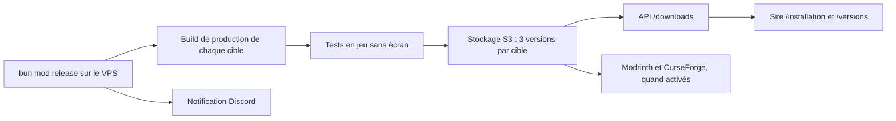
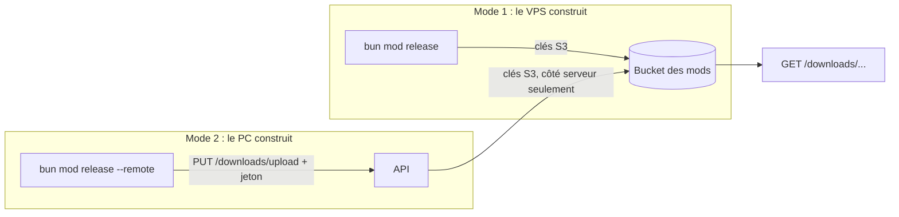

# Releases du mod

Le mod n'est plus construit ni publié par GitHub Actions. Un outil local, `bun mod` (`scripts/mod/`), construit tous les JAR sur le VPS de production, les teste sans écran, les range dans notre stockage S3 (Garage) et l'API les sert au site. Aucun workflow ne publie, ne tague ni ne pousse sur `main` : la CI GitHub (`quality.yml`) ne fait que contrôler les changements.

## Du VPS au site



`bun mod release [--skip-tests] [--no-publish] [--dry-run] [--bump patch|minor|beta [--commit]]` enchaîne, sous un verrou (une seule release à la fois) :

1. **Version** : lue dans `mod/1.21.1/gradle.properties` (`mod_version`, format `X.Y.Z-beta.N`). `--bump` l'incrémente d'abord ; `--commit` crée le commit `chore(release): <version>` et le tag local `mod-v<version>`. Rien n'est poussé automatiquement. `bun mod version [show | bump patch|minor|beta [--commit]]` fait la même chose seul : `patch` donne `X.Y.(Z+1)-beta.1`, `minor` donne `X.(Y+1).0-beta.1`, `beta` donne `X.Y.Z-beta.(N+1)`. Les versions des packages privés `apps/*` et `packages/*` ne suivent plus la version du mod.
2. **Build de production** de toutes les cibles activées de `mod/targets.json` : JAR, `.sha256` et `manifest.json` (version, Minecraft, loader, taille, empreinte, commit) dans `build/mod-dist/<version>/<id>/`. Une cible en échec n'arrête pas les autres.
3. **Tests en jeu sans écran** (voir plus bas) : une cible dont le test échoue n'est pas stockée.
4. **Stockage S3** des JAR réussis, puis réécriture de l'index (voir « Stockage et distribution du mod »).
5. **Publication tierce** si au moins un jeton Modrinth/CurseForge est présent et que la plateforme est activée ; sinon l'étape est ignorée.
6. **Notification Discord** de succès ou d'échec, avec la fin du journal.

`bun mod release --dry-run` affiche le plan (version, cibles, modules présents) sans rien construire ni envoyer. `bun mod status` montre la grille Minecraft x loader : état local, version publiée, espace utilisé. `bun mod build`, `bun mod test`, `bun mod storage`, `bun mod push`, `bun mod publish`, `bun mod notify`, `bun mod jdk` et `bun mod open` lancent chaque étape seule.

Les releases sont des **préversions** (`-beta.N`) : les tests automatisés ne valent pas une validation en jeu à la main du JAR exact. Une cible n'entre dans la matrice que si son adaptateur compile, que son loader est renseigné et qu'elle a été validée en jeu (`mod/targets.json`, `docs/features/loader-support.md`).

## Contrôle de CI

`.github/workflows/quality.yml` reste le seul contrôle à lire (`quality`). Pour un changement qui touche `mod/`, `mod/targets.json`, `scripts/gradle.mjs` ou `scripts/mod/`, il lance :

- le job `mod` : Biome sur `scripts/`, les tests `node --test scripts/mod/*.test.mjs scripts/mod/*/*.test.mjs`, puis `bun mod:check:ci` et `bun mod:build` sur la racine Gradle `mod/1.21.1` ;
- le job `mod-matrix` : une case par cible activée, listée par `node scripts/mod/cli.mjs ci`, compilée et contrôlée par Gradle. C'est le garde-fou qui empêche un portage de cesser de compiler en silence.

Ces jobs ne produisent aucun artefact et ne publient rien. `scripts/ci-scope.mjs` décide quelles portes un changement concerne ; un push sur `main` les lance toutes.

## Construction sur le VPS : notifications, tests sans écran, publication tierce

Ces briques sont appelées par `bun mod` (`scripts/mod/`) ; chacune se lance aussi seule.

### Notifications Discord

`scripts/mod/notify.mjs` envoie un embed au webhook `MOD_DISCORD_WEBHOOK_URL` (variable d'environnement, jamais dans le dépôt). Sans webhook : un avertissement, aucun envoi. La fonction ne lève jamais d'exception : un 429 attend `retry_after` (plafonné à 30 s), les erreurs réseau et 5xx sont retentées quatre fois au plus, un 4xx est abandonné. Vert pour `release-success` (une ligne par cible : version, taille en Mo, durée), rouge pour les échecs (cible, étape, trente dernières lignes du journal dans un bloc de code, lien du journal), orange pour `storage-warning`. Les limites de Discord (titre 256, description 4096, 25 champs, 1024 par valeur, 6000 au total) sont appliquées avant l'envoi. Tout message passe par un masquage : URLs de webhook, jetons connus, valeurs des variables d'environnement qui ressemblent à des secrets, affectations `TOKEN=…`, chemins personnels (`/home/<nom>` devient `~`).

- `bun mod notify --test` envoie un message de test ; avec `--dry-run`, affiche le JSON sans l'envoyer.
- `bun mod notify --kind release-failure --title … --summary … --log-stdin` lit la fin du journal sur l'entrée standard (utilisé par l'unité `OnFailure=`).
- Non testé contre un vrai Discord tant qu'aucun webhook n'existe : les tests simulent `fetch`.

### Tests en jeu sans écran

`bun mod test [<id>…|--all] [--keep-logs] [--notify]` lance, une cible après l'autre, le test client existant (tâches exactes dans `loader-support.md` : `:fabric:runClientGameTest` pour Fabric 1.21.11, `:forge:runClient -PgameTest=true` pour Forge 1.21.11, `:<loader>:runClientGametest` ailleurs) sous `xvfb-run` avec le rendu logiciel Mesa (`LIBGL_ALWAYS_SOFTWARE=1`, llvmpipe). Gradle tourne sur le JDK 21, le jeu sur le JDK de la cible (`java` dans `mod/targets.json`) ; les JDK sont cherchés dans `MOD_JDK_<majeure>`, `JAVA_HOME_<majeure>` puis `~/.local/tools/jdk-<majeure>*`. Une seule instance de Minecraft à la fois ; tas du jeu `MOD_TEST_GAME_MEMORY_MB` (2048 par défaut) imposé par `_JAVA_OPTIONS`, délai par cible `MOD_TEST_TIMEOUT_SECONDS` (1500). Le processus reçoit une liste blanche de variables : jamais les jetons ni les clés S3.

Après le test, le GLB `<gametest-home>/export/capture.glb` est relu (`summary.txt` si le GLB est illisible) et comparé aux minimums de `scripts/mod/headless/thresholds.json` (octets, maillages, matériaux, images, nœuds ; défauts plus des surcharges par id). Les contrôles fins (matériaux attendus, modes alpha BLEND et MASK) restent ceux de `GlbReport` dans le jeu. Le nombre de blocs n'est pas écrit dans le rapport : il n'est pas seuillé. Une cible est `skipped` avec un message clair si Xvfb, Mesa, un JDK ou `gradlew` manque, ou si elle n'a pas de test automatique (NeoForge, Fabric et Forge 1.21.1, Quilt). Le journal complet est dans `build/mod-test-logs/<id>.log` (supprimé en cas de succès sauf `--keep-logs`).

Pas de test « démarrage de serveur dédié » : le mod est client uniquement (`"environment": "client"`, mixins et rendu côté client) et aucun fichier de build ne définit de configuration de serveur ; un tel démarrage ne testerait rien du mod.

### Publication tierce (Modrinth, CurseForge)

`bun mod publish [--version X] [--dry-run]` publie les JAR de `build/mod-dist/<version>/<id>/`. Configuration dans `mod/catalogs.json` ; jetons uniquement par `MODRINTH_TOKEN` et `CURSEFORGE_TOKEN` (jamais journalisés, masqués dans `--dry-run`). Tant que le catalogue est désactivé, que le projet manque ou que le jeton manque, chaque résultat est `skipped` avec la liste exacte de ce qu'il reste à faire. `--dry-run` n'envoie rien : il construit les requêtes (JSON des métadonnées, nom et taille du fichier) et les affiche. Chaque résultat porte l'URL de la page (`url`) pour l'index du site, et `release.published[plateforme][cible]` permet de sauter ce qui est déjà en ligne.

- Modrinth (API v2) : `POST /v2/version` en multipart (`data` + fichier), `Authorization` sans `Bearer`, `User-Agent` `For-Hives/minemories/<version> (<contact>)`. Idempotent : la liste des versions du projet est lue d'abord, le numéro de version est `<version>+<loader>-mc<minecraft>`. Fabric dépend de `fabric-api` (slug résolu en identifiant).
- CurseForge : `POST https://minecraft.curseforge.com/api/projects/{id}/upload-file` (`metadata` + `file`, en-tête `X-Api-Token`). Les identifiants de versions de jeu (Minecraft, chargeur, Java, environnement Client) viennent de `GET /api/game/versions`, mis en cache un jour dans `build/mod-cache/`. L'API d'envoi ne permet pas de lister les fichiers : l'idempotence passe par l'index du site.
- Les versions `-beta.N` sont publiées en `beta`.

Pour finir plus tard :

1. Créer le projet sur Modrinth et sur CurseForge (mod client, licence, description, images).
2. Renseigner `projectId` (et `slug`) de chaque plateforme dans `mod/catalogs.json`, passer `enabled` à `true`.
3. Créer un jeton personnel Modrinth (portée création de version) et un jeton d'envoi CurseForge ; les mettre dans `/etc/minemories/mod-builder.env`.
4. Vérifier `mapping` (noms de chargeurs CurseForge : `Fabric`, `Forge`, `NeoForge`, `Quilt`) et le `contact` du `User-Agent` Modrinth.
5. Essayer `bun mod publish --dry-run`, puis une première publication à la main sur une version beta et contrôler la page.

### Exécution sur le VPS de production

Fichiers dans `ops/mod-builder/` : `install.sh` (idempotent : Xvfb, Mesa llvmpipe, bibliothèques X/ALSA minimales, outils de base, utilisateur système `minemories`, Bun épinglé, JDK 8/17/21/25 par `bun mod jdk`, unités systemd), `minemories-mod-release.service` et `.timer` (contrôle nocturne à 03h30 heure de Paris, `bun mod release`), `minemories-mod.slice` (limites cgroup), `minemories-mod-notify-failure@.service` (`OnFailure=` : alerte Discord avec la fin du journal) et `mod-builder.env.example` (modèle du fichier de secrets `/etc/minemories/mod-builder.env`, hors dépôt).

Le build ne doit jamais affamer le site ni l'API qui vivent sur la même machine :

- une seule instance : unité `oneshot`, `flock` sur `/run/lock/minemories-mod.lock`, tests en jeu séquentiels ;
- `Nice=19`, ordonnancement CPU et E/S `idle` ;
- tranche cgroup dédiée : `MemoryHigh=2560M` (le noyau ralentit le build), `MemoryMax=3G` (l'OOM killer ne choisit alors que dans la tranche), `CPUQuota=150%`, `TasksMax=2048` ; à ajuster à la taille réelle du VPS ;
- fenêtre horaire creuse (nuit) pour le contrôle quotidien, `Persistent=true` rattrape une nuit manquée ;
- sans swap sur une petite machine, un fichier de 2 Go absorbe les pointes des JVM (`install.sh` le signale).

Commandes utiles : `systemctl start minemories-mod-release.service`, `journalctl -fu minemories-mod-release`, `systemctl list-timers minemories-mod-release.timer`. L'effet réel de ces limites n'a pas été mesuré sur le VPS de production.

## Stockage et distribution du mod

Les JAR vivent dans notre stockage S3 (Garage), dans un bucket dédié (ou, à défaut, sous un préfixe réservé du bucket des captures : voir « Bucket dédié ou préfixe »), alimenté par `bun mod` et servi publiquement par l’API. Le site lit l’index de l’API.

### Deux modes de publication

Toute la logique du stockage (clés, schéma de l’index, idempotence, index écrit en dernier, `latest/`, rétention) est dans un seul paquet, `packages/mod-storage` (`@minemories/mod-storage`), importé par l’outil (`scripts/mod/storage/index.mjs` n’en garde que l’interface publique) et par l’API. Les deux modes écrivent donc exactement les mêmes objets.



| | Mode 1 : VPS direct | Mode 2 : PC via l’API |
| --- | --- | --- |
| Commande | `bun mod release` (timer systemd) | `bun mod release --remote`, ou `bun mod push [<version>]` pour ce qui est déjà dans `build/mod-dist/<version>/` |
| Secret sur la machine de build | clés S3 d’écriture | `MOD_UPLOAD_TOKEN` seulement ; les clés S3 ne quittent jamais le serveur |
| Qui écrit dans S3 | l’outil | l’API (`PUT /downloads/upload/...`) |
| `builtBy` dans l’index | `vps` (`MOD_BUILT_BY=vps` dans l’unité systemd) | `pc` (défaut) |
| Publication Modrinth / CurseForge | oui, quand activée | non : elle reste côté VPS |
| Lecture de ce qui est publié | `bun mod status` (S3) | `bun mod status --remote` (index public, sans clés S3) |

Les deux modes sont indépendants : on peut utiliser l’un, l’autre, ou les deux sur la même version (un JAR renvoyé avec les mêmes octets ne change rien). Un JAR construit sur le PC et le même commit construit sur le VPS ne sont **pas forcément identiques octet pour octet** (JDK, horodatages d’archive, ordre des entrées) : c’est pourquoi chaque entrée de l’index porte `builtBy` (`pc` ou `vps`) et pourquoi renvoyer une version déjà publiée avec un autre contenu est refusé (409) sauf demande explicite (`--replace`).

### Disposition du bucket

Les clés ci-dessous sont **relatives au préfixe** `MOD_STORAGE_PREFIX` (vide par défaut) : avec `public-mods/`, l'objet réel est `public-mods/index.json`, `public-mods/mods/...`, `public-mods/latest/...`.

```text
index.json                                           index des versions (écrit en dernier, atomiquement)
mods/<targetId>/<version>/minemories-<targetId>-<version>.jar
mods/<targetId>/<version>/minemories-<targetId>-<version>.jar.sha256   (si présent à côté du JAR)
mods/<targetId>/<version>/manifest.json                                (si présent)
latest/<targetId>.jar                                copie stable de la dernière version
```

`<targetId>` est l’identifiant de cible `<loader>-mc<minecraft>` (ex. `fabric-mc1.21.11`). `storeRelease` téléverse chaque JAR (multipart au-delà de 8 Mio), relit l’objet pour vérifier sa taille et son SHA-256, met à jour `latest/` puis réécrit `index.json` en dernier : un échec en cours de route laisse l’index inchangé et il ne pointe jamais vers un objet absent. Re-stocker la même version est idempotent (un objet identique n’est pas renvoyé).

### Schéma de `index.json`

```json
{
  "schema": 1,
  "generatedAt": "2026-10-20T10:00:00Z",
  "targets": {
    "fabric-mc1.21.11": {
      "loader": "fabric", "minecraft": "1.21.11", "loaderVersion": "0.20.1", "java": "21",
      "fabricApi": "0.140.0+1.21.11",
      "latest": "0.37.0",
      "versions": [
        { "version": "0.37.0", "builtAt": "2026-10-20T10:00:00Z", "commit": "abc1234", "bytes": 300220,
          "sha256": "…64 hex…", "key": "mods/fabric-mc1.21.11/0.37.0/minemories-fabric-mc1.21.11-0.37.0.jar",
          "builtBy": "vps", "pinned": true, "published": { "modrinth": "https://…", "curseforge": "https://…" } }
      ]
    }
  }
}
```

Les versions sont triées de la plus récente à la plus ancienne ; `fabricApi`, `builtBy`, `pinned` et `published` sont facultatifs (`builtBy` manque aux entrées antérieures à l’envoi par l’API). Le typedef JSDoc est dans `packages/mod-storage/src/index.mjs` et le schéma zod (`modIndex`) dans `packages/api-contract/src/mod-downloads.ts`.

### Rétention

`bun mod storage prune` conserve les **3 versions les plus récentes par cible**. Ne sont jamais supprimées : la version `latest`, les versions épinglées (`pinned`) et celles déjà référencées par une publication tierce (`published`). La suppression est en simulation par défaut ; `--yes` réécrit d’abord l’index, puis supprime les objets (un objet orphelin est inoffensif, un index pointant dans le vide non). Le site n’affiche que les 3 versions retenues par cible.

### Variables d’environnement

| Variable | Défaut | Rôle |
| --- | --- | --- |
| `MOD_STORAGE_BUCKET` | `minemories-mods` | Bucket des JAR. Distinct de `S3_BUCKET` (captures) sauf en configuration à préfixe, voir ci-dessous. |
| `MOD_STORAGE_PREFIX` | vide | Préfixe de toutes les clés des mods. Vide, ou un seul niveau `[a-z0-9][a-z0-9-]*/` de 1 à 40 caractères terminé par `/` (ex. `public-mods/`). Toute autre valeur fait échouer le démarrage de l'API (et de la route d'envoi) ou de l'outil `bun mod`. |
| `S3_ENDPOINT`, `S3_REGION`, `S3_ACCESS_KEY`, `S3_SECRET_KEY` | identiques à l’API (Garage local) | Connexion S3 partagée avec `apps/api`. |
| `MOD_S3_ENDPOINT`, `MOD_S3_REGION`, `MOD_S3_ACCESS_KEY`, `MOD_S3_SECRET_KEY` | valeur `S3_*` | Surcharge facultative pour l’outil de release (clés d’écriture distinctes de celles de l’API). |
| `MOD_STORAGE_WARN_BYTES` | 5 Gio | Seuil d’alerte de `bun mod storage status`. |
| `MOD_INDEX_CACHE_MS` | 15000 | Durée du cache mémoire de l’index côté API (vidé aussitôt après un envoi). |
| `MOD_STORAGE_KEEP` | 3 | Versions conservées par cible après un envoi par l’API (l’outil local utilise `--keep`, 3 par défaut). |
| `MOD_UPLOAD_TOKEN` | absent | **API** : active `PUT /downloads/upload/...` (32 caractères minimum, sinon la route répond 404). **Outil** : jeton envoyé par `--remote` et `push`. |
| `MOD_UPLOAD_MAX_BYTES` | 16777216 (16 Mio) | Taille maximale d’un JAR reçu par l’API. |
| `MOD_API_URL` | `https://api.minemories.net` | **Outil** : API qui reçoit les JAR (aussi `--api-url`). HTTP clair refusé hors `localhost`, `127.0.0.1` et `[::1]`. |
| `MOD_BUILT_BY` | `pc` | **Outil** : machine de build, `pc` ou `vps`, écrite dans `manifest.json` puis dans l’index. |

Hors production, le bucket est créé s’il manque ; en production (`NODE_ENV=production`) il doit être provisionné explicitement. Sans `MOD_UPLOAD_TOKEN`, l’API n’a besoin que d’un accès en lecture ; avec, elle a besoin d’un accès en lecture et écriture au bucket des mods (les identifiants `S3_*` de l’API, comme pour les captures).

### Bucket dédié ou préfixe

Deux configurations de production possibles :

1. **Bucket dédié** (préférée) : `MOD_STORAGE_BUCKET=minemories-mods`, `MOD_STORAGE_PREFIX` vide. Isolation complète des captures.
2. **Bucket des captures + préfixe** (quand on ne peut pas créer de bucket, comme sur Garage sous Coolify sans shell) : `MOD_STORAGE_BUCKET=minemories` (la valeur de `S3_BUCKET`) et `MOD_STORAGE_PREFIX=public-mods/`.

Préfixe recommandé : `public-mods/`. L'API nomme les objets des captures `<userId>/<uuid>.glb` et `<userId>/tiers/<uuid>.glb` (`apps/api/src/index.ts`, `uploads.ts`, `tier-locations.ts` ; `<userId>` est un identifiant Better Auth aléatoire de 32 caractères alphanumériques, sans trait d'union). `public-mods` contient un trait d'union et 11 caractères : il ne peut pas être un identifiant d'utilisateur, et aucune clé de mod (`public-mods/index.json`, `public-mods/mods/...`, `public-mods/latest/...`) ne ressemble à `<id>/<uuid>.glb`. Le rapprochement de stockage (`storage-reconciliation`) ne met en file de suppression que les clés `<propriétaire connu>/<uuid>.glb` : une clé de mod y est classée « à revoir » (`unknown_key_or_owner`), jamais supprimée.

Conception : le préfixe est appliqué à un seul endroit du paquet partagé (`at()` dans `packages/mod-storage/src/index.mjs`), utilisé par l'outil, la route d'envoi et la lecture publique, pas par des remplacements dispersés.

- **Les clés de l'index sont relatives au préfixe** (`mods/<id>/<version>/...jar`, jamais `public-mods/mods/...`). Changer de préfixe, ou passer d'un bucket dédié à un préfixe en copiant les objets, ne casse donc pas l'index. L'API reconstruit la clé réelle en lisant `<préfixe><clé de l'index>`.
- **Les listings sont bornés au préfixe** : la rétention (`prune`), `storageReport` et `ls` ne lisent, ne comptent et ne suppriment jamais une clé hors du préfixe (une clé hors préfixe renvoyée par le stockage est ignorée, et une suppression est refusée hors de `mods/`). Sans préfixe, `storageReport` compte tout le bucket (comportement historique) : ne pas partager un bucket sans préfixe.
- **L'API ne construit jamais une clé depuis l'URL** : `targetId` et `version` sont validés puis cherchés dans l'index, et la clé résolue doit rester sous `<préfixe>mods/` ou `<préfixe>latest/` (sans `..`, `//` ni `/` initial), sinon 404. Un index corrompu ne peut donc pas faire servir `users/...` ou une capture. `validateIndex` applique la même règle à l'écriture.
- Le préfixe ne peut ni contenir `.` ni `/` interne : `..` et `//` sont inexprimables.

**Mise en garde** : dans la configuration 2, les mods partagent le bucket des captures privées, isolés **seulement** par le préfixe. Il n'y a aucun accès public direct au bucket : l'API ne sert que les clés listées dans l'index, et l'identifiant S3 de l'API a de toute façon accès à tout le bucket. N'activez pas d'accès public ou de CDN sur le bucket des captures pour servir les mods.

### Commandes

- `bun mod storage status` : espace par cible et total, alerte au-delà du seuil.
- `bun mod storage ls` : versions de l’index (`latest`, `pinned`, `published`).
- `bun mod storage prune [--yes] [--keep N]` : rétention (simulation sans `--yes`).
- `bun mod storage pin <id> <version>` / `unpin <id> <version>` : épingle une version pour la soustraire à la rétention.
- `bun mod release --remote [--api-url <url>] [--replace]` : mode PC. Construit puis envoie chaque JAR à l’API au lieu d’appeler `storeRelease` ; vérifie l’URL et le jeton avant le build, ne publie rien chez des tiers, notifie Discord comme en mode local. Le code de sortie est 1 si une cible a échoué (les autres sont quand même envoyées).
- `bun mod push [<version>] [--api-url <url>] [--replace] [--dry-run]` : envoie ce qui est déjà dans `build/mod-dist/<version>/` sans recompiler (version courante par défaut).
- `bun mod status --remote` (ou `--api-url <url>`) : lit l’index public de l’API au lieu de S3.

Côté outil (`scripts/mod/remote/index.mjs`, `uploadRelease`) : une requête par JAR, nouvelles tentatives (4 essais, attente 1 s, 2 s, 4 s) sur erreur réseau ou 5xx seulement, jamais sur 401, 409 ou 422 ; le SHA-256 renvoyé doit être celui du fichier ; une fois tout envoyé, `GET /downloads/index.json` confirme que chaque version est publiée (3 lectures). Le jeton ne se passe jamais en argument ; il est masqué dans le journal, les erreurs et les notifications.

### Routes de l’API

Publiques, sans authentification, lues depuis le bucket des mods (les JAR sont envoyés en flux, jamais chargés entièrement en mémoire) :

- `GET /downloads/index.json` : l’index, `Cache-Control: public, max-age=60, must-revalidate` et `ETag` (304 sur `If-None-Match`). Un bucket sans index donne un index vide.
- `GET /downloads/:targetId/latest` : dernier JAR de la cible (cache court).
- `GET /downloads/:targetId/:version` : JAR d’une version listée dans l’index (`immutable`).

Les JAR sont envoyés avec `Content-Type: application/java-archive`, `Content-Disposition: attachment; filename="minemories-<targetId>-<version>.jar"`, `ETag` (le SHA-256), `X-Content-SHA256` et `X-Minemories-Version`. Les paramètres sont validés strictement (400 sinon) et la clé d’objet provient toujours de l’index, jamais de l’URL ; une cible ou une version inconnue (ou purgée) répond 404 ; une panne du stockage répond 503 `downloads_unavailable` sans détail interne.

#### Envoi d’un JAR (mode PC)

`PUT /downloads/upload/:targetId/:version`, corps = les octets bruts du JAR. Route destinée à l’outil, pas aux navigateurs : montée avant le middleware CORS (aucun en-tête CORS), réponses `Cache-Control: no-store`.

| En-tête | Rôle |
| --- | --- |
| `Authorization: Bearer <MOD_UPLOAD_TOKEN>` | obligatoire |
| `Content-Length` | obligatoire (411 sans), entre 1 octet et `MOD_UPLOAD_MAX_BYTES` |
| `X-Content-SHA256` | obligatoire, 64 hexadécimaux minuscules ; recalculé pendant la réception |
| `X-Mod-Manifest` | obligatoire, JSON encodé en base64url (4096 caractères au plus) : `id` (`<loader>-mc<minecraft>`), `version`, `minecraft`, `loader`, `loaderVersion`, `java`, `fabricApi?`, `commit`, `builtAt` (ISO 8601), `builtBy` (`pc` ou `vps`) ; l’`id` et la `version` doivent être ceux de l’URL, et `<loader>-mc<minecraft>` doit redonner l’`id` |

Paramètre facultatif : `?replace=1` pour remplacer une version existante dont le contenu diffère.

| Code | Corps | Cas |
| --- | --- | --- |
| 200 | `{ ok: true, targetId, version, sha256, bytes, latest, replaced }` | stocké, ou déjà présent avec les mêmes octets (idempotent : rien n’est réécrit) |
| 400 | `invalid_parameter`, `invalid_length`, `invalid_sha256`, `invalid_manifest`, `length_mismatch` | paramètre ou en-tête invalide, corps plus court que `Content-Length` |
| 401 | `unauthorized` | jeton absent ou faux (message identique dans les deux cas) |
| 404 | `not_found` | `MOD_UPLOAD_TOKEN` absent ou de moins de 32 caractères : la route ne révèle pas son existence |
| 409 | `version_exists` | même version, autre contenu, sans `?replace=1` |
| 411 | `length_required` | pas de `Content-Length` (corps en morceaux) |
| 413 | `too_large` | plus gros que `MOD_UPLOAD_MAX_BYTES` (refusé dès l’en-tête, ou en cours de réception) |
| 422 | `manifest_mismatch`, `sha256_mismatch`, `invalid_jar` | manifeste incohérent avec l’URL, empreinte fausse, pas une archive ZIP (signature `PK\x03\x04`) ou aucune entrée `.class` dans le répertoire central |
| 429 | `too_many_attempts` (`Retry-After: 60`) | 10 jetons faux en une minute depuis la même adresse (`TRUSTED_PROXY_IPS` pour l’adresse réelle derrière un proxy) |
| 503 | `busy` (`Retry-After: 5`), `upload_unavailable` | deux réceptions déjà en cours ; panne du stockage (événement générique `mod_upload_failed`, sans détail) |

Le jeton est comparé à temps constant (empreintes SHA-256) et n’est jamais journalisé ni renvoyé. Le corps est écrit en flux dans un fichier du répertoire temporaire de l’OS, haché au passage (jamais plus d’un morceau en mémoire), puis supprimé quoi qu’il arrive. Après un stockage réussi, la rétention (`MOD_STORAGE_KEEP`) s’applique comme `bun mod storage prune --yes` : jamais `latest`, ni une version épinglée ou publiée. Le cache de l’index public est vidé, donc la nouvelle version est visible tout de suite.

**Une seule instance d’API.** La mise à jour de l’index (lecture, modification, écriture) est protégée par un verrou en mémoire du processus : avec plusieurs instances, deux envois simultanés pourraient s’écraser l’un l’autre. Le déploiement Coolify actuel n’a qu’une instance ; si l’API est un jour répliquée, retirer `MOD_UPLOAD_TOKEN` de toutes sauf une (la route répond alors 404), ou ajouter un verrou partagé.

#### Générer, faire tourner et protéger le jeton

- Générer : `openssl rand -hex 32` (64 caractères). Le mettre dans les variables de l’API (Coolify) et dans le `.env` du PC (non versionné) ou dans l’environnement du shell : `MOD_UPLOAD_TOKEN=… bun mod release --remote`.
- Rotation : générer un nouveau jeton, le poser dans l’API puis redéployer, puis mettre à jour le PC. L’ancien cesse de fonctionner au redéploiement. En cas de fuite, retirer `MOD_UPLOAD_TOKEN` de l’API désactive la route aussitôt (404).
- Le jeton donne le droit d’ajouter ou de remplacer des JAR publics : le traiter comme un secret de publication. Les JAR passent les contrôles ci-dessus, mais l’API ne peut pas savoir si le code est digne de confiance.

#### Mise en service sur Coolify (mode PC)

1. Créer le bucket des mods dans Garage (`MOD_STORAGE_BUCKET`, `minemories-mods` par défaut) et donner à la clé S3 de l’API un accès lecture et écriture dessus.
2. Dans l’application API de Coolify : variables S3 du bucket des mods (`S3_ENDPOINT`, `S3_REGION`, `S3_ACCESS_KEY`, `S3_SECRET_KEY`, comme pour les captures), `MOD_STORAGE_BUCKET`, `MOD_UPLOAD_TOKEN` (jeton généré ci-dessus), éventuellement `MOD_STORAGE_KEEP`, `MOD_UPLOAD_MAX_BYTES` et `TRUSTED_PROXY_IPS`. Une seule instance.
3. Déployer. Vérifier que `curl -i -X PUT https://api.minemories.net/downloads/upload/x/1` répond 401 (route active) et que `GET /downloads/index.json` répond 200.
4. Sur le PC : `MOD_UPLOAD_TOKEN=… bun mod release --remote` (ou `bun mod build --all` puis `bun mod push`), puis `bun mod status --remote` et la page `/installation`.

#### Limites

- Une seule instance d’API pour la route d’envoi (voir plus haut).
- Les JAR du PC et du VPS ne sont pas forcément identiques octet pour octet ; `builtBy` dit qui a construit ce qui est servi. Renvoyer une version existante avec d’autres octets exige `--replace`.
- Le mode PC ne publie pas chez Modrinth ni CurseForge, et les tests en jeu sans écran exigent Xvfb et Mesa (`--skip-tests` les saute proprement).
- L’API contrôle la forme (archive ZIP, au moins une classe, taille, empreinte), pas le contenu : une release envoyée depuis le PC n’est pas pour autant validée en jeu.

### Validation

Tests du paquet de stockage et de l’outil avec un faux client S3 et un `fetch` simulé : `node --test packages/mod-storage/src/*.test.mjs scripts/mod/storage/*.test.mjs scripts/mod/remote/*.test.mjs`. Tests HTTP de la route d’envoi : `apps/api/src/mod-upload.test.ts` (`bun api:check`). Test réel contre un Garage jetable (stockage, multipart, index, téléchargement par l’API, rétention, et envoi par la route `PUT /downloads/upload` : mauvais jeton, empreinte fausse, JAR sans classe, conflit, remplacement, rétention) : `bun api:garage`.

## Vérifications de développement

- `node --test scripts/*.test.mjs scripts/mod/*.test.mjs scripts/mod/*/*.test.mjs packages/mod-storage/src/*.test.mjs` (ou `bun run scripts:test` pour la part utilisée par `bun check`) : outil `bun mod`, stockage avec faux client S3, publication tierce simulée, scope de la CI ; aucune publication externe depuis les tests.
- `bun check` et `bun run build` incluent ces tests et les contrôles habituels.
- `actionlint` : syntaxe et expressions des workflows.

## Checklist de mise en service

1. Installer le VPS avec `ops/mod-builder/install.sh`, remplir `/etc/minemories/mod-builder.env` (S3, webhook Discord, jetons de catalogue le moment venu).
2. Provisionner le bucket des mods (`MOD_STORAGE_BUCKET`) et donner à l'API un accès en lecture seule (mode VPS seul) ou en lecture et écriture avec `MOD_UPLOAD_TOKEN` (mode PC, voir « Mise en service sur Coolify »).
3. `bun mod notify --test`, `bun mod jdk`, puis `bun mod release --dry-run` et `bun mod status`.
4. Premier `systemctl start minemories-mod-release.service` à la main, lire `journalctl -fu minemories-mod-release`, vérifier `/downloads/index.json` et la page `/installation`.
5. Activer la publication tierce quand les projets existent (section dédiée plus haut).
