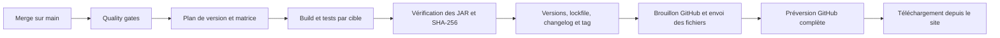

# Releases automatiques du monorepo

## Outils et périmètre

GitHub Actions orchestre le pipeline. `release-it` 21.1.1 et `@release-it/conventional-changelog` 12.0.2 calculent la version, écrivent le changelog et créent le commit/tag. Ils conviennent au monorepo Bun/Gradle sans registre npm et sans seconde PR de release. Le CLI GitHub publie les artefacts déjà construits. Node 24.15+ est recommandé ; les workflows installent Node 24 et Bun 1.4.3.

Les packages privés et le mod utilisent une version commune à chaque release. Il n’y a aucune publication npm. Le canal automatique est **beta** ; les catalogues restent une distribution distincte après validation en jeu. Les bibliothèques de release ne sont pas embarquées dans le client ni le JAR.

## Du merge à la release



1. `Quality gates` doit réussir sur le **commit exact poussé sur main**, pas seulement sur la tête de la PR avant son rebase. Le workflow `automatic-release.yml` ne consomme ni les événements de PR ni ceux des forks. Il vérifie aussi le succès via l’API Actions, y compris lors d’un lancement manuel.
2. Le plan refuse un checkout différent ou un commit de main déjà dépassé. Release-it lit les tags `mod-v*`, y compris l’ancienne bêta, puis calcule la prochaine version. Le plan contient version, source, canal et cibles ; aucun fichier versionné ni tag n’est modifié à ce stade.
3. La matrice est générée depuis `mod/targets.json`. Chaque job repart du commit testé, nettoie les anciens builds et lance les contrôles du loader et le build avec `-PmodVersion=<version>`. Les contrôles de `core` et `common` ne sont rejoués dans chaque cellule que pour un lancement manuel ; après un workflow *Quality gates* réussi sur le même commit, ils ne le sont pas (`RELEASE_SHARED_CHECKS_DONE`). Gradle est exécuté avec Java 25 en CI et compile pour Java 21. Chaque cible conserve son JAR, sa compatibilité, son empreinte et un reçu de build.
4. Le job de publication n’existe que si tous les builds réussissent. Il accepte l’extraction à plat d’une cible unique par download-artifact, ou les dossiers nommés d’une matrice multiple, en vérifiant la liste exacte des fichiers/cibles. Il refuse les cibles manquantes/en trop, les mauvaises versions/sources et les archives ou empreintes modifiées.
5. Release-it synchronise le root, tous les manifests des workspaces `apps/*` et `packages/*`, `bun.lock` et `mod_version` dans `mod/1.21.1/gradle.properties`. Il met à jour `CHANGELOG.md`, crée `chore(release): <version> [skip ci]` puis un tag annoté `mod-v<version>`. Le push branche/tag est atomique et n’utilise jamais de force.
6. Le tag est sur le commit de version, dont le parent est le commit construit/testé. Les seuls changements admis dans ce commit sont les manifests des packages, le lockfile, la propriété Gradle et le changelog. Le manifeste public conserve le SHA du source testé.
7. La release GitHub est d’abord un brouillon marqué prerelease. Le pipeline utilise directement la réponse de création du brouillon, sans attendre sa visibilité dans la liste des releases GitHub. Elle devient visible seulement après l’envoi de tous les fichiers. Un fichier existant différent est refusé ; aucune option `--clobber` ne l’écrase.

Le `GITHUB_TOKEN` standard suffit : lecture pour le plan/build, `actions:read` pour vérifier Quality gates et `contents:write` uniquement pour le job de publication. Aucun PAT ni compte npm n’est nécessaire. Les règles du dépôt doivent permettre le push du commit de version par ce token ; un refus de protection fait échouer le pipeline, sans forcer la branche. Le commit `[skip ci]`, publié avec le token Actions, ne crée pas de boucle de releases.

## Règles de version

`.release-it.json` utilise Conventional Commits et `strictSemVer: true` :

| Changement depuis la dernière release | Exemple depuis `0.2.0-beta.1` |
| --- | --- |
| `fix:`, `perf:`, maintenance, docs/tests/CI | `0.2.1-beta.1` |
| `feat:` | `0.3.0-beta.1` |
| `feat!:`, autre `!` ou pied `BREAKING CHANGE:` | `1.0.0-beta.1` |

Le plus fort incrément de la plage l’emporte. Les sections du changelog incluent fonctionnalités, corrections, performances, refactorisation, build, CI, documentation, tests et maintenance. Un merge sans type exploitable reçoit au minimum un patch ; utiliser des titres conventionnels conserve un changelog lisible. Chaque merge peut produire une release, même s’il ne modifie que le web ; plusieurs merges très rapprochés peuvent être regroupés quand un commit de main est dépassé avant publication.

La première bêta manuelle `mod-v0.1.0-beta` est conservée comme référence historique. Les versions de développement existantes ne sont pas des releases. Le premier incrément automatique est calculé sur les commits non inclus dans cette bêta ; la série suivante utilise les nouveaux tags. Aucun bump de version publié n’est effectué dans cette PR de mise en place.

## Cibles et fichiers

Les cibles activées pour Minecraft 1.21.1 / Java 21 sont NeoForge 21.1.248, Fabric Loader 0.19.5 (Fabric API 0.116.17+1.21.1 requise) et Forge 52.1.19. Le JAR Fabric a aussi été exercé sous Quilt 0.30.1 ; aucune quatrième archive Quilt n’est construite. Toute nouvelle cible exige un adaptateur Gradle compilable, une version de loader renseignée et une validation en jeu. `validatedInGame` signifie que la combinaison est prise en charge ; cela n’atteste pas que chaque nouvelle archive automatique a été exercée en jeu.

La release contient :

- `minemories-<loader>-mc<version>.jar` et son `.sha256` ;
- `manifest-<loader>-mc<version>.json` pour chaque cible ;
- `manifest.json`, alias conservé pour le téléchargement NeoForge 1.21.1 existant ;
- `release-manifest.json` avec version, source, validation automatisée, cibles, tailles et SHA-256.

Le nom `minemories-neoforge-mc1.21.1.jar` et le format des tags restent compatibles avec `/installation`. Le front récupère la release publiée depuis l’API GitHub ; aucun build Java n’est ajouté à Railpack/Coolify.

## Reprise et prévisualisation

- **Avant le commit/tag** : corriger le build ou les tests et relancer. Aucun tag ni release n’a été publié.
- **Après le push du commit/tag, pendant l’envoi** : utiliser **Re-run failed jobs** sur le même run Actions. Le plan et les artefacts conservés 30 jours permettent de reprendre la même version. Le job reconnaît le tag existant seulement si son parent, son sujet et son contenu correspondent au plan ; il reprend le brouillon et compare les digests des fichiers déjà envoyés.
- **Après une publication complète** : relancer le job ne crée pas une deuxième release et ne modifie pas les fichiers. Une divergence provoque une erreur explicite.
- **Nouveau merge pendant un build** : un commit dépassé est ignoré avant publication ; un push concurrent est refusé sans force. Le run du nouveau main prendra les changements en compte.
- **Artefacts expirés ou suppression manuelle d’un tag/asset** : ne pas réécrire un tag déjà distribué. Inspecter le run et publier une nouvelle version depuis un main vérifié.

Le workflow peut être lancé manuellement sur `main` avec `dry_run=true` (défaut). Il calcule et construit la matrice sans commit, tag ni publication. Sa file de concurrence est séparée pour ne pas remplacer une release automatique en attente. Il exige tout de même une CI verte sur cette source. Un main qui pointe déjà sur un commit de version n’a rien à publier.

## Catalogues

`mod-release.yml` télécharge une release GitHub existante, compare les octets au digest fourni par GitHub et au manifeste/checksum, puis utilise `mc-publish` pour les destinations sélectionnées. Il conserve `tested_in_game`, les identifiants/secrets Modrinth/CurseForge et l’environnement `mod-releases`. Il ne compile plus le mod et ne crée plus de release GitHub concurrente.

## Construction sur le VPS : notifications, tests sans écran, publication tierce

Ces briques sont appelées par `bun mod` (`scripts/mod/`) ; chacune se lance aussi seule.

### Notifications Discord

`scripts/mod/notify.mjs` envoie un embed au webhook `MOD_DISCORD_WEBHOOK_URL` (variable d'environnement, jamais dans le dépôt). Sans webhook : un avertissement, aucun envoi. La fonction ne lève jamais d'exception : un 429 attend `retry_after` (plafonné à 30 s), les erreurs réseau et 5xx sont retentées quatre fois au plus, un 4xx est abandonné. Vert pour `release-success` (une ligne par cible : version, taille en Mo, durée), rouge pour les échecs (cible, étape, trente dernières lignes du journal dans un bloc de code, lien du journal), orange pour `storage-warning`. Les limites de Discord (titre 256, description 4096, 25 champs, 1024 par valeur, 6000 au total) sont appliquées avant l'envoi. Tout message passe par un masquage : URLs de webhook, jetons connus, valeurs des variables d'environnement qui ressemblent à des secrets, affectations `TOKEN=…`, chemins personnels (`/home/<nom>` devient `~`).

- `bun mod notify --test` envoie un message de test ; avec `--dry-run`, affiche le JSON sans l'envoyer.
- `bun mod notify --kind release-failure --title … --summary … --log-stdin` lit la fin du journal sur l'entrée standard (utilisé par l'unité `OnFailure=`).
- Non testé contre un vrai Discord tant qu'aucun webhook n'existe : les tests simulent `fetch`.

### Tests en jeu sans écran

`bun mod test [<id>…|--all] [--keep-logs] [--notify]` lance, une cible après l'autre, le test client existant (tâches exactes dans `loader-support.md` : `:fabric:runClientGameTest` pour Fabric 1.21.11, `:forge:runClient -PgameTest=true` pour Forge 1.21.11, `:<loader>:runClientGametest` ailleurs) sous `xvfb-run` avec le rendu logiciel Mesa (`LIBGL_ALWAYS_SOFTWARE=1`, llvmpipe). Gradle tourne sur le JDK 21, le jeu sur le JDK de la cible (`java` dans `mod/targets.json`) ; les JDK sont cherchés dans `MOD_JDK_<majeure>`, `JAVA_HOME_<majeure>` puis `~/.local/tools/jdk-<majeure>*`. Une seule instance de Minecraft à la fois ; tas du jeu `MOD_TEST_GAME_MEMORY_MB` (2048 par défaut) imposé par `_JAVA_OPTIONS`, délai par cible `MOD_TEST_TIMEOUT_SECONDS` (1500). Le processus reçoit une liste blanche de variables : jamais les jetons ni les clés S3.

Après le test, le GLB `<gametest-home>/export/capture.glb` est relu (`summary.txt` si le GLB est illisible) et comparé aux minimums de `scripts/mod/headless/thresholds.json` (octets, maillages, matériaux, images, nœuds ; défauts plus des surcharges par id). Les contrôles fins (matériaux attendus, modes alpha BLEND et MASK) restent ceux de `GlbReport` dans le jeu. Le nombre de blocs n'est pas écrit dans le rapport : il n'est pas seuillé. Une cible est `skipped` avec un message clair si Xvfb, Mesa, un JDK ou `gradlew` manque, ou si elle n'a pas de test automatique (NeoForge, Fabric et Forge 1.21.1, Quilt). Le journal complet est dans `build/mod-test-logs/<id>.log` (supprimé en cas de succès sauf `--keep-logs`).

Pas de test « démarrage de serveur dédié » : le mod est client uniquement (`"environment": "client"`, mixins et rendu côté client) et aucun fichier de build ne définit de configuration de serveur ; un tel démarrage ne testerait rien du mod.

### Publication tierce (Modrinth, CurseForge)

`bun mod publish [--version X] [--dry-run]` publie les JAR de `build/mod-dist/<version>/<id>/`. Configuration dans `mod/catalogs.json` ; jetons uniquement par `MODRINTH_TOKEN` et `CURSEFORGE_TOKEN` (jamais journalisés, masqués dans `--dry-run`). Tant que le catalogue est désactivé, que le projet manque ou que le jeton manque, chaque résultat est `skipped` avec la liste exacte de ce qu'il reste à faire. `--dry-run` n'envoie rien : il construit les requêtes (JSON des métadonnées, nom et taille du fichier) et les affiche. Chaque résultat porte l'URL de la page (`url`) pour l'index du site, et `release.published[plateforme][cible]` permet de sauter ce qui est déjà en ligne.

- Modrinth (API v2) : `POST /v2/version` en multipart (`data` + fichier), `Authorization` sans `Bearer`, `User-Agent` `For-Hives/minemories/<version> (<contact>)`. Idempotent : la liste des versions du projet est lue d'abord, le numéro de version est `<version>+<loader>-mc<minecraft>`. Fabric dépend de `fabric-api` (slug résolu en identifiant).
- CurseForge : `POST https://minecraft.curseforge.com/api/projects/{id}/upload-file` (`metadata` + `file`, en-tête `X-Api-Token`). Les identifiants de versions de jeu (Minecraft, chargeur, Java, environnement Client) viennent de `GET /api/game/versions`, mis en cache un jour dans `build/mod-cache/`. L'API d'envoi ne permet pas de lister les fichiers : l'idempotence passe par l'index du site.
- Les versions `-beta.N` sont publiées en `beta`.

Pour finir plus tard :

1. Créer le projet sur Modrinth et sur CurseForge (mod client, licence, description, images).
2. Renseigner `projectId` (et `slug`) de chaque plateforme dans `mod/catalogs.json`, passer `enabled` à `true`.
3. Créer un jeton personnel Modrinth (portée création de version) et un jeton d'envoi CurseForge ; les mettre dans `/etc/minemories/mod-builder.env`.
4. Vérifier `mapping` (noms de chargeurs CurseForge : `Fabric`, `Forge`, `NeoForge`, `Quilt`) et le `contact` du `User-Agent` Modrinth.
5. Essayer `bun mod publish --dry-run`, puis une première publication à la main sur une version beta et contrôler la page.
6. Le workflow `mod-release.yml` publie aussi via `mc-publish` : ne garder qu'un des deux chemins actifs.

### Exécution sur le VPS de production

Fichiers dans `ops/mod-builder/` : `install.sh` (idempotent : Xvfb, Mesa llvmpipe, bibliothèques X/ALSA minimales, outils de base, utilisateur système `minemories`, Bun épinglé, JDK 8/17/21/25 par `bun mod jdk`, unités systemd), `minemories-mod-release.service` et `.timer` (contrôle nocturne à 03h30 heure de Paris, `bun mod release`), `minemories-mod.slice` (limites cgroup), `minemories-mod-notify-failure@.service` (`OnFailure=` : alerte Discord avec la fin du journal) et `mod-builder.env.example` (modèle du fichier de secrets `/etc/minemories/mod-builder.env`, hors dépôt).

Le build ne doit jamais affamer le site ni l'API qui vivent sur la même machine :

- une seule instance : unité `oneshot`, `flock` sur `/run/lock/minemories-mod.lock`, tests en jeu séquentiels ;
- `Nice=19`, ordonnancement CPU et E/S `idle` ;
- tranche cgroup dédiée : `MemoryHigh=2560M` (le noyau ralentit le build), `MemoryMax=3G` (l'OOM killer ne choisit alors que dans la tranche), `CPUQuota=150%`, `TasksMax=2048` ; à ajuster à la taille réelle du VPS ;
- fenêtre horaire creuse (nuit) pour le contrôle quotidien, `Persistent=true` rattrape une nuit manquée ;
- sans swap sur une petite machine, un fichier de 2 Go absorbe les pointes des JVM (`install.sh` le signale).

Commandes utiles : `systemctl start minemories-mod-release.service`, `journalctl -fu minemories-mod-release`, `systemctl list-timers minemories-mod-release.timer`. L'effet réel de ces limites n'a pas été mesuré sur le VPS de production.

## Stockage et distribution du mod

Les JAR ne sont plus servis par GitHub Releases : ils vivent dans notre stockage S3 (Garage), dans un bucket dédié distinct des captures des utilisateurs, alimenté par `bun mod` (module `scripts/mod/storage/`) et servi publiquement par l’API. Le site lit l’index de l’API (plus de limite de débit GitHub, plus de dépendance au format des assets GitHub).

### Disposition du bucket

```text
index.json                                           index des versions (écrit en dernier, atomiquement)
mods/<targetId>/<version>/minemories-<targetId>-<version>.jar
mods/<targetId>/<version>/minemories-<targetId>-<version>.jar.sha256   (si présent à côté du JAR)
mods/<targetId>/<version>/manifest.json                                (si présent)
latest/<targetId>.jar                                copie stable de la dernière version
```

`<targetId>` est l’identifiant de cible `<loader>-mc<minecraft>` (ex. `fabric-mc1.21.11`). `storeRelease` téléverse chaque JAR (multipart au-delà de 8 Mio), relit l’objet pour vérifier sa taille et son SHA-256, met à jour `latest/` puis réécrit `index.json` en dernier : un échec en cours de route laisse l’index inchangé et il ne pointe jamais vers un objet absent. Re-stocker la même version est idempotent (un objet identique n’est pas renvoyé).

### Schéma de `index.json`

```json
{
  "schema": 1,
  "generatedAt": "2026-10-20T10:00:00Z",
  "targets": {
    "fabric-mc1.21.11": {
      "loader": "fabric", "minecraft": "1.21.11", "loaderVersion": "0.20.1", "java": "21",
      "fabricApi": "0.140.0+1.21.11",
      "latest": "0.37.0",
      "versions": [
        { "version": "0.37.0", "builtAt": "2026-10-20T10:00:00Z", "commit": "abc1234", "bytes": 300220,
          "sha256": "…64 hex…", "key": "mods/fabric-mc1.21.11/0.37.0/minemories-fabric-mc1.21.11-0.37.0.jar",
          "pinned": true, "published": { "modrinth": "https://…", "curseforge": "https://…" } }
      ]
    }
  }
}
```

Les versions sont triées de la plus récente à la plus ancienne ; `fabricApi`, `pinned` et `published` sont facultatifs. Le typedef JSDoc est dans `scripts/mod/storage/index.mjs` et le schéma zod (`modIndex`) dans `packages/api-contract/src/mod-downloads.ts`.

### Rétention

`bun mod storage prune` conserve les **3 versions les plus récentes par cible**. Ne sont jamais supprimées : la version `latest`, les versions épinglées (`pinned`) et celles déjà référencées par une publication tierce (`published`). La suppression est en simulation par défaut ; `--yes` réécrit d’abord l’index, puis supprime les objets (un objet orphelin est inoffensif, un index pointant dans le vide non). Le site n’affiche que les 3 versions retenues par cible.

### Variables d’environnement

| Variable | Défaut | Rôle |
| --- | --- | --- |
| `MOD_STORAGE_BUCKET` | `minemories-mods` | Bucket des JAR (distinct de `S3_BUCKET`, celui des captures). |
| `S3_ENDPOINT`, `S3_REGION`, `S3_ACCESS_KEY`, `S3_SECRET_KEY` | identiques à l’API (Garage local) | Connexion S3 partagée avec `apps/api`. |
| `MOD_S3_ENDPOINT`, `MOD_S3_REGION`, `MOD_S3_ACCESS_KEY`, `MOD_S3_SECRET_KEY` | valeur `S3_*` | Surcharge facultative pour l’outil de release (clés d’écriture distinctes de celles de l’API). |
| `MOD_STORAGE_WARN_BYTES` | 5 Gio | Seuil d’alerte de `bun mod storage status`. |
| `MOD_INDEX_CACHE_MS` | 15000 | Durée du cache mémoire de l’index côté API. |

Hors production, le bucket est créé s’il manque ; en production (`NODE_ENV=production`) il doit être provisionné explicitement. L’API n’a besoin que d’un accès en lecture.

### Commandes

- `bun mod storage status` : espace par cible et total, alerte au-delà du seuil.
- `bun mod storage ls` : versions de l’index (`latest`, `pinned`, `published`).
- `bun mod storage prune [--yes] [--keep N]` : rétention (simulation sans `--yes`).
- `bun mod storage pin <id> <version>` / `unpin <id> <version>` : épingle une version pour la soustraire à la rétention.

### Routes de l’API

Publiques, sans authentification, lues depuis le bucket des mods (les JAR sont envoyés en flux, jamais chargés entièrement en mémoire) :

- `GET /downloads/index.json` : l’index, `Cache-Control: public, max-age=60, must-revalidate` et `ETag` (304 sur `If-None-Match`). Un bucket sans index donne un index vide.
- `GET /downloads/:targetId/latest` : dernier JAR de la cible (cache court).
- `GET /downloads/:targetId/:version` : JAR d’une version listée dans l’index (`immutable`).

Les JAR sont envoyés avec `Content-Type: application/java-archive`, `Content-Disposition: attachment; filename="minemories-<targetId>-<version>.jar"`, `ETag` (le SHA-256), `X-Content-SHA256` et `X-Minemories-Version`. Les paramètres sont validés strictement (400 sinon) et la clé d’objet provient toujours de l’index, jamais de l’URL ; une cible ou une version inconnue (ou purgée) répond 404 ; une panne du stockage répond 503 `downloads_unavailable` sans détail interne.

### Validation

Tests unitaires du stockage avec un faux client S3 : `node --test scripts/mod/storage`. Test réel contre un Garage jetable (stockage, multipart, index, téléchargement par l’API, rétention) : `bun api:garage`.

## Vérifications de développement

- `bun release:test` : vrais dépôts Git locaux pour les versions/commits/tags/reprises et tests de fichiers pour la matrice, les empreintes et les catalogues ; aucune publication externe depuis les tests.
- `bun check` et `bun run build` : incluent les tests de release et les contrôles habituels.
- `actionlint` 1.7.12 : syntaxe et expressions des workflows.

Le pin `basic-ftp: 6.2.1` corrige la dépendance transitive de l’outillage de release signalée par `bun audit` (GHSA-c475-qrg2-pj4r). L’outillage est testé avec ce pin ; aucun support FTP n’est ajouté au produit.
