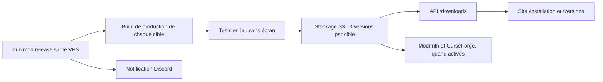

# Releases du mod

Le mod n'est plus construit ni publié par GitHub Actions. Un outil local, `bun mod` (`scripts/mod/`), construit tous les JAR sur le VPS de production, les teste sans écran, les range dans notre stockage S3 (Garage) et l'API les sert au site. Aucun workflow ne publie, ne tague ni ne pousse sur `main` : la CI GitHub (`quality.yml`) ne fait que contrôler les changements.

## Du VPS au site



`bun mod release [--skip-tests] [--no-publish] [--dry-run] [--bump patch|minor|beta [--commit]]` enchaîne, sous un verrou (une seule release à la fois) :

1. **Version** : lue dans `mod/1.21.1/gradle.properties` (`mod_version`, format `X.Y.Z-beta.N`). `--bump` l'incrémente d'abord ; `--commit` crée le commit `chore(release): <version>` et le tag local `mod-v<version>`. Rien n'est poussé automatiquement. `bun mod version [show | bump patch|minor|beta [--commit]]` fait la même chose seul : `patch` donne `X.Y.(Z+1)-beta.1`, `minor` donne `X.(Y+1).0-beta.1`, `beta` donne `X.Y.Z-beta.(N+1)`. Les versions des packages privés `apps/*` et `packages/*` ne suivent plus la version du mod.
2. **Build de production** de toutes les cibles activées de `mod/targets.json` : JAR, `.sha256` et `manifest.json` (version, Minecraft, loader, taille, empreinte, commit) dans `build/mod-dist/<version>/<id>/`. Une cible en échec n'arrête pas les autres.
3. **Tests en jeu sans écran** (voir plus bas) : une cible dont le test échoue n'est pas stockée.
4. **Stockage S3** des JAR réussis, puis réécriture de l'index (voir « Stockage et distribution du mod »).
5. **Publication tierce** si au moins un jeton Modrinth/CurseForge est présent et que la plateforme est activée ; sinon l'étape est ignorée.
6. **Notification Discord** de succès ou d'échec, avec la fin du journal.

`bun mod release --dry-run` affiche le plan (version, cibles, modules présents) sans rien construire ni envoyer. `bun mod status` montre la grille Minecraft x loader : état local, version publiée, espace utilisé. `bun mod build`, `bun mod test`, `bun mod storage`, `bun mod publish`, `bun mod notify`, `bun mod jdk` et `bun mod open` lancent chaque étape seule.

Les releases sont des **préversions** (`-beta.N`) : les tests automatisés ne valent pas une validation en jeu à la main du JAR exact. Une cible n'entre dans la matrice que si son adaptateur compile, que son loader est renseigné et qu'elle a été validée en jeu (`mod/targets.json`, `docs/features/loader-support.md`).

## Contrôle de CI

`.github/workflows/quality.yml` reste le seul contrôle à lire (`quality`). Pour un changement qui touche `mod/`, `mod/targets.json`, `scripts/gradle.mjs` ou `scripts/mod/`, il lance :

- le job `mod` : Biome sur `scripts/`, les tests `node --test scripts/mod/*.test.mjs scripts/mod/*/*.test.mjs`, puis `bun mod:check:ci` et `bun mod:build` sur la racine Gradle `mod/1.21.1` ;
- le job `mod-matrix` : une case par cible activée, listée par `node scripts/mod/cli.mjs ci`, compilée et contrôlée par Gradle. C'est le garde-fou qui empêche un portage de cesser de compiler en silence.

Ces jobs ne produisent aucun artefact et ne publient rien. `scripts/ci-scope.mjs` décide quelles portes un changement concerne ; un push sur `main` les lance toutes.

## Construction sur le VPS : notifications, tests sans écran, publication tierce

Ces briques sont appelées par `bun mod` (`scripts/mod/`) ; chacune se lance aussi seule.

### Notifications Discord

`scripts/mod/notify.mjs` envoie un embed au webhook `MOD_DISCORD_WEBHOOK_URL` (variable d'environnement, jamais dans le dépôt). Sans webhook : un avertissement, aucun envoi. La fonction ne lève jamais d'exception : un 429 attend `retry_after` (plafonné à 30 s), les erreurs réseau et 5xx sont retentées quatre fois au plus, un 4xx est abandonné. Vert pour `release-success` (une ligne par cible : version, taille en Mo, durée), rouge pour les échecs (cible, étape, trente dernières lignes du journal dans un bloc de code, lien du journal), orange pour `storage-warning`. Les limites de Discord (titre 256, description 4096, 25 champs, 1024 par valeur, 6000 au total) sont appliquées avant l'envoi. Tout message passe par un masquage : URLs de webhook, jetons connus, valeurs des variables d'environnement qui ressemblent à des secrets, affectations `TOKEN=…`, chemins personnels (`/home/<nom>` devient `~`).

- `bun mod notify --test` envoie un message de test ; avec `--dry-run`, affiche le JSON sans l'envoyer.
- `bun mod notify --kind release-failure --title … --summary … --log-stdin` lit la fin du journal sur l'entrée standard (utilisé par l'unité `OnFailure=`).
- Non testé contre un vrai Discord tant qu'aucun webhook n'existe : les tests simulent `fetch`.

### Tests en jeu sans écran

`bun mod test [<id>…|--all] [--keep-logs] [--notify]` lance, une cible après l'autre, le test client existant (tâches exactes dans `loader-support.md` : `:fabric:runClientGameTest` pour Fabric 1.21.11, `:forge:runClient -PgameTest=true` pour Forge 1.21.11, `:<loader>:runClientGametest` ailleurs) sous `xvfb-run` avec le rendu logiciel Mesa (`LIBGL_ALWAYS_SOFTWARE=1`, llvmpipe). Gradle tourne sur le JDK 21, le jeu sur le JDK de la cible (`java` dans `mod/targets.json`) ; les JDK sont cherchés dans `MOD_JDK_<majeure>`, `JAVA_HOME_<majeure>` puis `~/.local/tools/jdk-<majeure>*`. Une seule instance de Minecraft à la fois ; tas du jeu `MOD_TEST_GAME_MEMORY_MB` (2048 par défaut) imposé par `_JAVA_OPTIONS`, délai par cible `MOD_TEST_TIMEOUT_SECONDS` (1500). Le processus reçoit une liste blanche de variables : jamais les jetons ni les clés S3.

Après le test, le GLB `<gametest-home>/export/capture.glb` est relu (`summary.txt` si le GLB est illisible) et comparé aux minimums de `scripts/mod/headless/thresholds.json` (octets, maillages, matériaux, images, nœuds ; défauts plus des surcharges par id). Les contrôles fins (matériaux attendus, modes alpha BLEND et MASK) restent ceux de `GlbReport` dans le jeu. Le nombre de blocs n'est pas écrit dans le rapport : il n'est pas seuillé. Une cible est `skipped` avec un message clair si Xvfb, Mesa, un JDK ou `gradlew` manque, ou si elle n'a pas de test automatique (NeoForge, Fabric et Forge 1.21.1, Quilt). Le journal complet est dans `build/mod-test-logs/<id>.log` (supprimé en cas de succès sauf `--keep-logs`).

Pas de test « démarrage de serveur dédié » : le mod est client uniquement (`"environment": "client"`, mixins et rendu côté client) et aucun fichier de build ne définit de configuration de serveur ; un tel démarrage ne testerait rien du mod.

### Publication tierce (Modrinth, CurseForge)

`bun mod publish [--version X] [--dry-run]` publie les JAR de `build/mod-dist/<version>/<id>/`. Configuration dans `mod/catalogs.json` ; jetons uniquement par `MODRINTH_TOKEN` et `CURSEFORGE_TOKEN` (jamais journalisés, masqués dans `--dry-run`). Tant que le catalogue est désactivé, que le projet manque ou que le jeton manque, chaque résultat est `skipped` avec la liste exacte de ce qu'il reste à faire. `--dry-run` n'envoie rien : il construit les requêtes (JSON des métadonnées, nom et taille du fichier) et les affiche. Chaque résultat porte l'URL de la page (`url`) pour l'index du site, et `release.published[plateforme][cible]` permet de sauter ce qui est déjà en ligne.

- Modrinth (API v2) : `POST /v2/version` en multipart (`data` + fichier), `Authorization` sans `Bearer`, `User-Agent` `For-Hives/minemories/<version> (<contact>)`. Idempotent : la liste des versions du projet est lue d'abord, le numéro de version est `<version>+<loader>-mc<minecraft>`. Fabric dépend de `fabric-api` (slug résolu en identifiant).
- CurseForge : `POST https://minecraft.curseforge.com/api/projects/{id}/upload-file` (`metadata` + `file`, en-tête `X-Api-Token`). Les identifiants de versions de jeu (Minecraft, chargeur, Java, environnement Client) viennent de `GET /api/game/versions`, mis en cache un jour dans `build/mod-cache/`. L'API d'envoi ne permet pas de lister les fichiers : l'idempotence passe par l'index du site.
- Les versions `-beta.N` sont publiées en `beta`.

Pour finir plus tard :

1. Créer le projet sur Modrinth et sur CurseForge (mod client, licence, description, images).
2. Renseigner `projectId` (et `slug`) de chaque plateforme dans `mod/catalogs.json`, passer `enabled` à `true`.
3. Créer un jeton personnel Modrinth (portée création de version) et un jeton d'envoi CurseForge ; les mettre dans `/etc/minemories/mod-builder.env`.
4. Vérifier `mapping` (noms de chargeurs CurseForge : `Fabric`, `Forge`, `NeoForge`, `Quilt`) et le `contact` du `User-Agent` Modrinth.
5. Essayer `bun mod publish --dry-run`, puis une première publication à la main sur une version beta et contrôler la page.

### Exécution sur le VPS de production

Fichiers dans `ops/mod-builder/` : `install.sh` (idempotent : Xvfb, Mesa llvmpipe, bibliothèques X/ALSA minimales, outils de base, utilisateur système `minemories`, Bun épinglé, JDK 8/17/21/25 par `bun mod jdk`, unités systemd), `minemories-mod-release.service` et `.timer` (contrôle nocturne à 03h30 heure de Paris, `bun mod release`), `minemories-mod.slice` (limites cgroup), `minemories-mod-notify-failure@.service` (`OnFailure=` : alerte Discord avec la fin du journal) et `mod-builder.env.example` (modèle du fichier de secrets `/etc/minemories/mod-builder.env`, hors dépôt).

Le build ne doit jamais affamer le site ni l'API qui vivent sur la même machine :

- une seule instance : unité `oneshot`, `flock` sur `/run/lock/minemories-mod.lock`, tests en jeu séquentiels ;
- `Nice=19`, ordonnancement CPU et E/S `idle` ;
- tranche cgroup dédiée : `MemoryHigh=2560M` (le noyau ralentit le build), `MemoryMax=3G` (l'OOM killer ne choisit alors que dans la tranche), `CPUQuota=150%`, `TasksMax=2048` ; à ajuster à la taille réelle du VPS ;
- fenêtre horaire creuse (nuit) pour le contrôle quotidien, `Persistent=true` rattrape une nuit manquée ;
- sans swap sur une petite machine, un fichier de 2 Go absorbe les pointes des JVM (`install.sh` le signale).

Commandes utiles : `systemctl start minemories-mod-release.service`, `journalctl -fu minemories-mod-release`, `systemctl list-timers minemories-mod-release.timer`. L'effet réel de ces limites n'a pas été mesuré sur le VPS de production.

## Stockage et distribution du mod

Les JAR vivent dans notre stockage S3 (Garage), dans un bucket dédié distinct des captures des utilisateurs, alimenté par `bun mod` (module `scripts/mod/storage/`) et servi publiquement par l’API. Le site lit l’index de l’API.

### Disposition du bucket

```text
index.json                                           index des versions (écrit en dernier, atomiquement)
mods/<targetId>/<version>/minemories-<targetId>-<version>.jar
mods/<targetId>/<version>/minemories-<targetId>-<version>.jar.sha256   (si présent à côté du JAR)
mods/<targetId>/<version>/manifest.json                                (si présent)
latest/<targetId>.jar                                copie stable de la dernière version
```

`<targetId>` est l’identifiant de cible `<loader>-mc<minecraft>` (ex. `fabric-mc1.21.11`). `storeRelease` téléverse chaque JAR (multipart au-delà de 8 Mio), relit l’objet pour vérifier sa taille et son SHA-256, met à jour `latest/` puis réécrit `index.json` en dernier : un échec en cours de route laisse l’index inchangé et il ne pointe jamais vers un objet absent. Re-stocker la même version est idempotent (un objet identique n’est pas renvoyé).

### Schéma de `index.json`

```json
{
  "schema": 1,
  "generatedAt": "2026-10-20T10:00:00Z",
  "targets": {
    "fabric-mc1.21.11": {
      "loader": "fabric", "minecraft": "1.21.11", "loaderVersion": "0.20.1", "java": "21",
      "fabricApi": "0.140.0+1.21.11",
      "latest": "0.37.0",
      "versions": [
        { "version": "0.37.0", "builtAt": "2026-10-20T10:00:00Z", "commit": "abc1234", "bytes": 300220,
          "sha256": "…64 hex…", "key": "mods/fabric-mc1.21.11/0.37.0/minemories-fabric-mc1.21.11-0.37.0.jar",
          "pinned": true, "published": { "modrinth": "https://…", "curseforge": "https://…" } }
      ]
    }
  }
}
```

Les versions sont triées de la plus récente à la plus ancienne ; `fabricApi`, `pinned` et `published` sont facultatifs. Le typedef JSDoc est dans `scripts/mod/storage/index.mjs` et le schéma zod (`modIndex`) dans `packages/api-contract/src/mod-downloads.ts`.

### Rétention

`bun mod storage prune` conserve les **3 versions les plus récentes par cible**. Ne sont jamais supprimées : la version `latest`, les versions épinglées (`pinned`) et celles déjà référencées par une publication tierce (`published`). La suppression est en simulation par défaut ; `--yes` réécrit d’abord l’index, puis supprime les objets (un objet orphelin est inoffensif, un index pointant dans le vide non). Le site n’affiche que les 3 versions retenues par cible.

### Variables d’environnement

| Variable | Défaut | Rôle |
| --- | --- | --- |
| `MOD_STORAGE_BUCKET` | `minemories-mods` | Bucket des JAR (distinct de `S3_BUCKET`, celui des captures). |
| `S3_ENDPOINT`, `S3_REGION`, `S3_ACCESS_KEY`, `S3_SECRET_KEY` | identiques à l’API (Garage local) | Connexion S3 partagée avec `apps/api`. |
| `MOD_S3_ENDPOINT`, `MOD_S3_REGION`, `MOD_S3_ACCESS_KEY`, `MOD_S3_SECRET_KEY` | valeur `S3_*` | Surcharge facultative pour l’outil de release (clés d’écriture distinctes de celles de l’API). |
| `MOD_STORAGE_WARN_BYTES` | 5 Gio | Seuil d’alerte de `bun mod storage status`. |
| `MOD_INDEX_CACHE_MS` | 15000 | Durée du cache mémoire de l’index côté API. |

Hors production, le bucket est créé s’il manque ; en production (`NODE_ENV=production`) il doit être provisionné explicitement. L’API n’a besoin que d’un accès en lecture.

### Commandes

- `bun mod storage status` : espace par cible et total, alerte au-delà du seuil.
- `bun mod storage ls` : versions de l’index (`latest`, `pinned`, `published`).
- `bun mod storage prune [--yes] [--keep N]` : rétention (simulation sans `--yes`).
- `bun mod storage pin <id> <version>` / `unpin <id> <version>` : épingle une version pour la soustraire à la rétention.

### Routes de l’API

Publiques, sans authentification, lues depuis le bucket des mods (les JAR sont envoyés en flux, jamais chargés entièrement en mémoire) :

- `GET /downloads/index.json` : l’index, `Cache-Control: public, max-age=60, must-revalidate` et `ETag` (304 sur `If-None-Match`). Un bucket sans index donne un index vide.
- `GET /downloads/:targetId/latest` : dernier JAR de la cible (cache court).
- `GET /downloads/:targetId/:version` : JAR d’une version listée dans l’index (`immutable`).

Les JAR sont envoyés avec `Content-Type: application/java-archive`, `Content-Disposition: attachment; filename="minemories-<targetId>-<version>.jar"`, `ETag` (le SHA-256), `X-Content-SHA256` et `X-Minemories-Version`. Les paramètres sont validés strictement (400 sinon) et la clé d’objet provient toujours de l’index, jamais de l’URL ; une cible ou une version inconnue (ou purgée) répond 404 ; une panne du stockage répond 503 `downloads_unavailable` sans détail interne.

### Validation

Tests unitaires du stockage avec un faux client S3 : `node --test scripts/mod/storage`. Test réel contre un Garage jetable (stockage, multipart, index, téléchargement par l’API, rétention) : `bun api:garage`.

## Vérifications de développement

- `node --test scripts/*.test.mjs scripts/mod/*.test.mjs scripts/mod/*/*.test.mjs` (ou `bun run scripts:test` pour la part utilisée par `bun check`) : outil `bun mod`, stockage avec faux client S3, publication tierce simulée, scope de la CI ; aucune publication externe depuis les tests.
- `bun check` et `bun run build` incluent ces tests et les contrôles habituels.
- `actionlint` : syntaxe et expressions des workflows.

## Checklist de mise en service

1. Installer le VPS avec `ops/mod-builder/install.sh`, remplir `/etc/minemories/mod-builder.env` (S3, webhook Discord, jetons de catalogue le moment venu).
2. Provisionner le bucket des mods (`MOD_STORAGE_BUCKET`) et donner à l'API un accès en lecture seule.
3. `bun mod notify --test`, `bun mod jdk`, puis `bun mod release --dry-run` et `bun mod status`.
4. Premier `systemctl start minemories-mod-release.service` à la main, lire `journalctl -fu minemories-mod-release`, vérifier `/downloads/index.json` et la page `/installation`.
5. Activer la publication tierce quand les projets existent (section dédiée plus haut).
