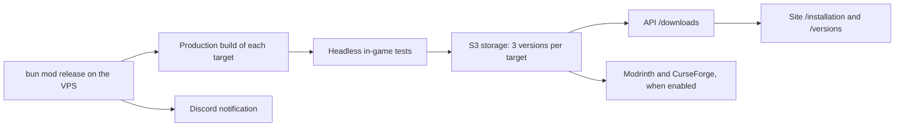
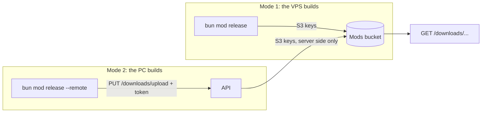

# Mod releases

The mod is no longer built or published by GitHub Actions. A local tool, `bun mod` (`scripts/mod/`), builds every JAR on the production VPS, tests them headless, stores them in our S3 storage (Garage), and the API serves them to the site. No workflow publishes, tags or pushes to `main`: GitHub CI (`quality.yml`) only checks changes.

## From the VPS to the site



`bun mod release [--skip-tests] [--no-publish] [--dry-run] [--bump patch|minor|beta [--commit]]` runs the following steps under a lock (one release at a time):

1. **Version**: read from `mod/1.21.1/gradle.properties` (`mod_version`, format `X.Y.Z-beta.N`). `--bump` increments it first; `--commit` creates the `chore(release): <version>` commit and the local `mod-v<version>` tag. Nothing is pushed automatically. `bun mod version [show | bump patch|minor|beta [--commit]]` does the same on its own: `patch` gives `X.Y.(Z+1)-beta.1`, `minor` gives `X.(Y+1).0-beta.1`, `beta` gives `X.Y.Z-beta.(N+1)`. The versions of the private `apps/*` and `packages/*` packages no longer follow the mod version.
2. **Production build** of every enabled target in `mod/targets.json`: JAR, `.sha256` and `manifest.json` (version, Minecraft, loader, size, checksum, commit) in `build/mod-dist/<version>/<id>/`. A failing target does not stop the others.
3. **Headless in-game tests** (see below): a target whose test fails is not stored.
4. **S3 storage** of the successful JARs, then the index is rewritten (see "Mod storage and distribution").
5. **Third-party publication** if at least one Modrinth/CurseForge token is present and the platform is enabled; otherwise the step is skipped.
6. **Discord notification** of success or failure, with the end of the log.

`bun mod release --dry-run` prints the plan (version, targets, modules present) without building or sending anything. `bun mod status` shows the Minecraft x loader grid: local state, published version, space used. `bun mod build`, `bun mod test`, `bun mod storage`, `bun mod push`, `bun mod publish`, `bun mod notify`, `bun mod jdk` and `bun mod open` run each step on its own.

Releases are **pre-releases** (`-beta.N`): automated tests are not equivalent to manual in-game validation of the exact JAR. A target enters the matrix only if its adapter compiles, its loader is filled in and it has been validated in game (`mod/targets.json`, `docs/features/loader-support.md`).

## CI check

`.github/workflows/quality.yml` remains the only check to read (`quality`). For a change touching `mod/`, `mod/targets.json`, `scripts/gradle.mjs` or `scripts/mod/`, it runs:

- the `mod` job: Biome on `scripts/`, the `node --test scripts/mod/*.test.mjs scripts/mod/*/*.test.mjs` tests, then `bun mod:check:ci` and `bun mod:build` on the `mod/1.21.1` Gradle root;
- the `mod-matrix` job: one cell per enabled target, listed by `node scripts/mod/cli.mjs ci`, compiled and checked by Gradle. This is the guard that stops a port from silently ceasing to compile.

These jobs produce no artifact and publish nothing. `scripts/ci-scope.mjs` decides which gates a change concerns; a push to `main` runs all of them.

## Building on the VPS: notifications, headless tests, third-party publication

These building blocks are called by `bun mod` (`scripts/mod/`); each one can also run on its own.

### Discord notifications

`scripts/mod/notify.mjs` sends an embed to the `MOD_DISCORD_WEBHOOK_URL` webhook (an environment variable, never in the repository). Without a webhook: a warning and nothing sent. The function never throws: a 429 waits for `retry_after` (capped at 30 s), network errors and 5xx are retried at most four times, a 4xx is given up. Green for `release-success` (one line per target: version, size in MB, duration), red for failures (target, step, the last thirty log lines in a code block, log link), orange for `storage-warning`. Discord's limits (title 256, description 4096, 25 fields, 1024 per value, 6000 in total) are applied before sending. Every message goes through redaction: webhook URLs, known tokens, values of environment variables that look like secrets, `TOKEN=…` assignments, personal paths (`/home/<name>` becomes `~`).

- `bun mod notify --test` sends a test message; with `--dry-run`, it prints the JSON without sending it.
- `bun mod notify --kind release-failure --title … --summary … --log-stdin` reads the end of the log from standard input (used by the `OnFailure=` unit).
- Not tested against a real Discord while no webhook exists: the tests mock `fetch`.

### Headless in-game tests

`bun mod test [<id>…|--all] [--keep-logs] [--notify]` runs, one target after another, the existing client test (exact tasks in `loader-support.md`: `:fabric:runClientGameTest` for Fabric 1.21.11, `:forge:runClient -PgameTest=true` for Forge 1.21.11, `:<loader>:runClientGametest` elsewhere) under `xvfb-run` with Mesa software rendering (`LIBGL_ALWAYS_SOFTWARE=1`, llvmpipe). Gradle runs on JDK 21, the game on the target's JDK (`java` in `mod/targets.json`); JDKs are looked up in `MOD_JDK_<major>`, `JAVA_HOME_<major>`, then `~/.local/tools/jdk-<major>*`. Only one Minecraft instance at a time; game heap `MOD_TEST_GAME_MEMORY_MB` (2048 by default) enforced through `_JAVA_OPTIONS`, per-target timeout `MOD_TEST_TIMEOUT_SECONDS` (1500). The process receives an allowlist of variables: never the tokens or the S3 keys.

After the test, the GLB `<gametest-home>/export/capture.glb` is read back (`summary.txt` if the GLB is unreadable) and compared with the minimums in `scripts/mod/headless/thresholds.json` (bytes, meshes, materials, images, nodes; defaults plus per-id overrides). Fine-grained checks (expected materials, BLEND and MASK alpha modes) stay with `GlbReport` in the game. The block count is not written to the report, so it has no threshold. A target is `skipped` with a clear message if Xvfb, Mesa, a JDK or `gradlew` is missing, or if it has no automated test (NeoForge, Fabric and Forge 1.21.1, Quilt). The full log is in `build/mod-test-logs/<id>.log` (deleted on success unless `--keep-logs`).

There is no "dedicated server startup" test: the mod is client-only (`"environment": "client"`, client-side mixins and rendering) and no build file defines a server configuration; such a startup would test nothing of the mod.

### Third-party publication (Modrinth, CurseForge)

`bun mod publish [--version X] [--dry-run]` publishes the JARs from `build/mod-dist/<version>/<id>/`. Configuration lives in `mod/catalogs.json`; tokens come only from `MODRINTH_TOKEN` and `CURSEFORGE_TOKEN` (never logged, redacted in `--dry-run`). As long as the catalog is disabled, or the project or token is missing, each result is `skipped` with the exact list of what remains to be done. `--dry-run` sends nothing: it builds the requests (metadata JSON, file name and size) and prints them. Each result carries the page URL (`url`) for the site index, and `release.published[platform][target]` lets already-published items be skipped.

- Modrinth (API v2): multipart `POST /v2/version` (`data` + file), `Authorization` without `Bearer`, `User-Agent` `For-Hives/minemories/<version> (<contact>)`. Idempotent: the project's version list is read first, and the version number is `<version>+<loader>-mc<minecraft>`. Fabric depends on `fabric-api` (slug resolved to an identifier).
- CurseForge: `POST https://minecraft.curseforge.com/api/projects/{id}/upload-file` (`metadata` + `file`, `X-Api-Token` header). Game version identifiers (Minecraft, loader, Java, Client environment) come from `GET /api/game/versions`, cached for one day in `build/mod-cache/`. The upload API cannot list files: idempotence relies on the site index.
- `-beta.N` versions are published as `beta`.

To finish later:

1. Create the project on Modrinth and on CurseForge (client mod, license, description, images).
2. Fill in each platform's `projectId` (and `slug`) in `mod/catalogs.json`, and set `enabled` to `true`.
3. Create a Modrinth personal token (version creation scope) and a CurseForge upload token; put them in `/etc/minemories/mod-builder.env`.
4. Check `mapping` (CurseForge loader names: `Fabric`, `Forge`, `NeoForge`, `Quilt`) and the `contact` in the Modrinth `User-Agent`.
5. Try `bun mod publish --dry-run`, then a first manual publication of a beta version, and check the page.

### Running on the production VPS

Files in `ops/mod-builder/`: `install.sh` (idempotent: Xvfb, Mesa llvmpipe, minimal X/ALSA libraries, base tools, `minemories` system user, pinned Bun, JDK 8/17/21/25 through `bun mod jdk`, systemd units), `minemories-mod-release.service` and `.timer` (nightly check at 03:30 Paris time, `bun mod release`), `minemories-mod.slice` (cgroup limits), `minemories-mod-notify-failure@.service` (`OnFailure=`: Discord alert with the end of the log) and `mod-builder.env.example` (template for the `/etc/minemories/mod-builder.env` secrets file, kept out of the repository).

The build must never starve the site or the API living on the same machine:

- a single instance: `oneshot` unit, `flock` on `/run/lock/minemories-mod.lock`, sequential in-game tests;
- `Nice=19`, `idle` CPU and I/O scheduling;
- a dedicated cgroup slice: `MemoryHigh=2560M` (the kernel slows the build down), `MemoryMax=3G` (the OOM killer then only picks inside the slice), `CPUQuota=150%`, `TasksMax=2048`; adjust to the VPS's real size;
- an off-peak time window (night) for the daily check, `Persistent=true` catches up a missed night;
- without swap on a small machine, a 2 GB swap file absorbs JVM spikes (`install.sh` flags it).

Useful commands: `systemctl start minemories-mod-release.service`, `journalctl -fu minemories-mod-release`, `systemctl list-timers minemories-mod-release.timer`. The real effect of these limits has not been measured on the production VPS.

## Mod storage and distribution

JARs live in our S3 storage (Garage), in a dedicated bucket (or, failing that, under a reserved prefix of the captures bucket: see "Dedicated bucket or prefix"), fed by `bun mod` and served publicly by the API. The site reads the API's index.

### Two publication modes

All storage logic (keys, index schema, idempotence, index written last, `latest/`, retention) lives in a single package, `packages/mod-storage` (`@minemories/mod-storage`), imported by the tool (`scripts/mod/storage/index.mjs` keeps only its public interface) and by the API. Both modes therefore write exactly the same objects.



| | Mode 1: VPS direct | Mode 2: PC through the API |
| --- | --- | --- |
| Command | `bun mod release` (systemd timer) | `bun mod release --remote`, or `bun mod push [<version>]` for what is already in `build/mod-dist/<version>/` |
| Secret on the build machine | S3 write keys | `MOD_UPLOAD_TOKEN` only; S3 keys never leave the server |
| Who writes to S3 | the tool | the API (`PUT /downloads/upload/...`) |
| `builtBy` in the index | `vps` (`MOD_BUILT_BY=vps` in the systemd unit) | `pc` (default) |
| Modrinth / CurseForge publication | yes, when enabled | no: it stays on the VPS |
| Reading what is published | `bun mod status` (S3) | `bun mod status --remote` (public index, no S3 keys) |

The two modes are independent: you can use one, the other, or both on the same version (a JAR re-sent with the same bytes changes nothing). A JAR built on the PC and the same commit built on the VPS are **not necessarily byte-for-byte identical** (JDK, archive timestamps, entry order): that is why every index entry carries `builtBy` (`pc` or `vps`) and why re-sending an already published version with different content is refused (409) unless explicitly requested (`--replace`).

### Bucket layout

The keys below are **relative to the prefix** `MOD_STORAGE_PREFIX` (empty by default): with `public-mods/`, the actual object is `public-mods/index.json`, `public-mods/mods/...`, `public-mods/latest/...`.

```text
index.json                                           version index (written last, atomically)
mods/<targetId>/<version>/minemories-<targetId>-<version>.jar
mods/<targetId>/<version>/minemories-<targetId>-<version>.jar.sha256   (if present next to the JAR)
mods/<targetId>/<version>/manifest.json                                (if present)
latest/<targetId>.jar                                stable copy of the latest version
```

`<targetId>` is the target identifier `<loader>-mc<minecraft>` (e.g. `fabric-mc1.21.11`). `storeRelease` uploads each JAR (multipart above 8 MiB), reads the object back to check its size and SHA-256, updates `latest/`, then rewrites `index.json` last: a failure midway leaves the index unchanged and it never points to a missing object. Storing the same version again is idempotent (an identical object is not re-sent).

### `index.json` schema

```json
{
  "schema": 1,
  "generatedAt": "2026-10-20T10:00:00Z",
  "targets": {
    "fabric-mc1.21.11": {
      "loader": "fabric", "minecraft": "1.21.11", "loaderVersion": "0.20.1", "java": "21",
      "fabricApi": "0.140.0+1.21.11",
      "latest": "0.37.0",
      "versions": [
        { "version": "0.37.0", "builtAt": "2026-10-20T10:00:00Z", "commit": "abc1234", "bytes": 300220,
          "sha256": "…64 hex…", "key": "mods/fabric-mc1.21.11/0.37.0/minemories-fabric-mc1.21.11-0.37.0.jar",
          "builtBy": "vps", "pinned": true, "published": { "modrinth": "https://…", "curseforge": "https://…" } }
      ]
    }
  }
}
```

Versions are sorted from newest to oldest; `fabricApi`, `builtBy`, `pinned` and `published` are optional (`builtBy` is missing from entries that predate uploads through the API). The JSDoc typedef is in `packages/mod-storage/src/index.mjs` and the zod schema (`modIndex`) in `packages/api-contract/src/mod-downloads.ts`.

### Retention

`bun mod storage prune` keeps the **3 most recent versions per target**. Never deleted: the `latest` version, pinned versions (`pinned`) and those already referenced by a third-party publication (`published`). Deletion is a simulation by default; `--yes` rewrites the index first, then deletes the objects (an orphan object is harmless, an index pointing at nothing is not). The site only shows the 3 versions kept per target.

### Environment variables

| Variable | Default | Role |
| --- | --- | --- |
| `MOD_STORAGE_BUCKET` | `minemories-mods` | JAR bucket. Separate from `S3_BUCKET` (captures) except in the prefix configuration, see below. |
| `MOD_STORAGE_PREFIX` | empty | Prefix for every mod key. Empty, or a single level `[a-z0-9][a-z0-9-]*/` of 1 to 40 characters ending in `/` (e.g. `public-mods/`). Any other value makes the API (and the upload route) or the `bun mod` tool fail at startup. |
| `S3_ENDPOINT`, `S3_REGION`, `S3_ACCESS_KEY`, `S3_SECRET_KEY` | same as the API (local Garage) | S3 connection shared with `apps/api`. |
| `MOD_S3_ENDPOINT`, `MOD_S3_REGION`, `MOD_S3_ACCESS_KEY`, `MOD_S3_SECRET_KEY` | `S3_*` value | Optional override for the release tool (write keys separate from the API's). |
| `MOD_STORAGE_WARN_BYTES` | 5 GiB | Alert threshold for `bun mod storage status`. |
| `MOD_INDEX_CACHE_MS` | 15000 | Lifetime of the API's in-memory index cache (cleared right after an upload). |
| `MOD_STORAGE_KEEP` | 3 | Versions kept per target after an upload through the API (the local tool uses `--keep`, 3 by default). |
| `MOD_UPLOAD_TOKEN` | absent | **API**: enables `PUT /downloads/upload/...` (at least 32 characters, otherwise the route returns 404). **Tool**: token sent by `--remote` and `push`. |
| `MOD_UPLOAD_MAX_BYTES` | 16777216 (16 MiB) | Maximum size of a JAR received by the API. |
| `MOD_API_URL` | `https://api.minemories.net` | **Tool**: API that receives the JARs (also `--api-url`). Plain HTTP is refused outside `localhost`, `127.0.0.1` and `[::1]`. |
| `MOD_BUILT_BY` | `pc` | **Tool**: build machine, `pc` or `vps`, written to `manifest.json` and then to the index. |

Outside production, the bucket is created if missing; in production (`NODE_ENV=production`) it must be provisioned explicitly. Without `MOD_UPLOAD_TOKEN`, the API only needs read access; with it, the API needs read and write access to the mods bucket (the API's `S3_*` credentials, as for captures).

### Dedicated bucket or prefix

Two possible production configurations:

1. **Dedicated bucket** (preferred): `MOD_STORAGE_BUCKET=minemories-mods`, `MOD_STORAGE_PREFIX` empty. Full isolation from captures.
2. **Captures bucket + prefix** (when a bucket cannot be created, as with Garage under Coolify without a shell): `MOD_STORAGE_BUCKET=minemories` (the value of `S3_BUCKET`) and `MOD_STORAGE_PREFIX=public-mods/`.

Recommended prefix: `public-mods/`. The API names capture objects `<userId>/<uuid>.glb` and `<userId>/tiers/<uuid>.glb` (`apps/api/src/index.ts`, `uploads.ts`, `tier-locations.ts`; `<userId>` is a random 32-character alphanumeric Better Auth identifier, without hyphens). `public-mods` contains a hyphen and is 11 characters long: it cannot be a user identifier, and no mod key (`public-mods/index.json`, `public-mods/mods/...`, `public-mods/latest/...`) looks like `<id>/<uuid>.glb`. Storage reconciliation (`storage-reconciliation`) only queues `<known owner>/<uuid>.glb` keys for deletion: a mod key is classified "to review" (`unknown_key_or_owner`), never deleted.

Design: the prefix is applied in a single place in the shared package (`at()` in `packages/mod-storage/src/index.mjs`), used by the tool, the upload route and public reads, rather than by scattered replacements.

- **Index keys are relative to the prefix** (`mods/<id>/<version>/...jar`, never `public-mods/mods/...`). Changing the prefix, or moving from a dedicated bucket to a prefix by copying the objects, therefore does not break the index. The API rebuilds the real key by reading `<prefix><index key>`.
- **Listings are bounded to the prefix**: retention (`prune`), `storageReport` and `ls` never read, count or delete a key outside the prefix (an out-of-prefix key returned by storage is ignored, and a deletion outside `mods/` is refused). Without a prefix, `storageReport` counts the whole bucket (historical behavior): do not share a bucket without a prefix.
- **The API never builds a key from the URL**: `targetId` and `version` are validated and then looked up in the index, and the resolved key must stay under `<prefix>mods/` or `<prefix>latest/` (without `..`, `//` or a leading `/`), otherwise 404. A corrupted index therefore cannot make the API serve `users/...` or a capture. `validateIndex` applies the same rule on write.
- The prefix can contain neither `.` nor an inner `/`: `..` and `//` cannot be expressed.

**Warning**: in configuration 2, the mods share the private captures bucket and are isolated **only** by the prefix. There is no direct public access to the bucket: the API only serves keys listed in the index, and the API's S3 credentials have access to the whole bucket anyway. Do not enable public access or a CDN on the captures bucket to serve the mods.

### Commands

- `bun mod storage status`: space per target and in total, alert above the threshold.
- `bun mod storage ls`: index versions (`latest`, `pinned`, `published`).
- `bun mod storage prune [--yes] [--keep N]`: retention (simulation without `--yes`).
- `bun mod storage pin <id> <version>` / `unpin <id> <version>`: pins a version to exempt it from retention.
- `bun mod release --remote [--api-url <url>] [--replace]`: PC mode. Builds, then sends each JAR to the API instead of calling `storeRelease`; checks the URL and the token before the build, publishes nothing to third parties, notifies Discord as in local mode. The exit code is 1 if a target failed (the others are still sent).
- `bun mod push [<version>] [--api-url <url>] [--replace] [--dry-run]`: sends what is already in `build/mod-dist/<version>/` without recompiling (current version by default).
- `bun mod status --remote` (or `--api-url <url>`): reads the API's public index instead of S3.

On the tool side (`scripts/mod/remote/index.mjs`, `uploadRelease`): one request per JAR, retries (4 attempts, waiting 1 s, 2 s, 4 s) on network errors or 5xx only, never on 401, 409 or 422; the returned SHA-256 must match the file; once everything is sent, `GET /downloads/index.json` confirms that each version is published (3 reads). The token is never passed as an argument; it is redacted in the log, errors and notifications.

### API routes

Public, unauthenticated, read from the mods bucket (JARs are streamed, never loaded fully into memory):

- `GET /downloads/index.json`: the index, `Cache-Control: public, max-age=60, must-revalidate` and `ETag` (304 on `If-None-Match`). A bucket without an index yields an empty index.
- `GET /downloads/:targetId/latest`: the target's latest JAR (short cache).
- `GET /downloads/:targetId/:version`: the JAR of a version listed in the index (`immutable`).

JARs are sent with `Content-Type: application/java-archive`, `Content-Disposition: attachment; filename="minemories-<targetId>-<version>.jar"`, `ETag` (the SHA-256), `X-Content-SHA256` and `X-Minemories-Version`. Parameters are strictly validated (400 otherwise) and the object key always comes from the index, never from the URL; an unknown (or purged) target or version returns 404; a storage outage returns 503 `downloads_unavailable` without internal details.

#### Uploading a JAR (PC mode)

`PUT /downloads/upload/:targetId/:version`, body = the raw JAR bytes. This route is meant for the tool, not for browsers: it is mounted before the CORS middleware (no CORS headers), with `Cache-Control: no-store` responses.

| Header | Role |
| --- | --- |
| `Authorization: Bearer <MOD_UPLOAD_TOKEN>` | required |
| `Content-Length` | required (411 without it), between 1 byte and `MOD_UPLOAD_MAX_BYTES` |
| `X-Content-SHA256` | required, 64 lowercase hex characters; recomputed while receiving |
| `X-Mod-Manifest` | required, base64url-encoded JSON (at most 4096 characters): `id` (`<loader>-mc<minecraft>`), `version`, `minecraft`, `loader`, `loaderVersion`, `java`, `fabricApi?`, `commit`, `builtAt` (ISO 8601), `builtBy` (`pc` or `vps`); `id` and `version` must match the URL, and `<loader>-mc<minecraft>` must give back the `id` |

Optional parameter: `?replace=1` to replace an existing version whose content differs.

| Code | Body | Case |
| --- | --- | --- |
| 200 | `{ ok: true, targetId, version, sha256, bytes, latest, replaced }` | stored, or already present with the same bytes (idempotent: nothing is rewritten) |
| 400 | `invalid_parameter`, `invalid_length`, `invalid_sha256`, `invalid_manifest`, `length_mismatch` | invalid parameter or header, body shorter than `Content-Length` |
| 401 | `unauthorized` | missing or wrong token (same message in both cases) |
| 404 | `not_found` | `MOD_UPLOAD_TOKEN` absent or shorter than 32 characters: the route does not reveal that it exists |
| 409 | `version_exists` | same version, different content, without `?replace=1` |
| 411 | `length_required` | no `Content-Length` (chunked body) |
| 413 | `too_large` | larger than `MOD_UPLOAD_MAX_BYTES` (refused from the header, or while receiving) |
| 422 | `manifest_mismatch`, `sha256_mismatch`, `invalid_jar` | manifest inconsistent with the URL, wrong checksum, not a ZIP archive (`PK\x03\x04` signature) or no `.class` entry in the central directory |
| 429 | `too_many_attempts` (`Retry-After: 60`) | 10 wrong tokens in one minute from the same address (`TRUSTED_PROXY_IPS` for the real address behind a proxy) |
| 503 | `busy` (`Retry-After: 5`), `upload_unavailable` | two uploads already being received; storage outage (generic `mod_upload_failed` event, without details) |

The token is compared in constant time (SHA-256 digests) and is never logged or returned. The body is streamed into a file in the OS temporary directory, hashed on the way (never more than one chunk in memory), then deleted no matter what. After successful storage, retention (`MOD_STORAGE_KEEP`) applies like `bun mod storage prune --yes`: never `latest`, nor a pinned or published version. The public index cache is cleared, so the new version is visible right away.

**A single API instance.** Updating the index (read, modify, write) is protected by an in-process memory lock: with several instances, two simultaneous uploads could overwrite each other. The current Coolify deployment has a single instance; if the API is ever replicated, remove `MOD_UPLOAD_TOKEN` from all but one (the route then returns 404), or add a shared lock.

#### Generating, rotating and protecting the token

- Generate: `openssl rand -hex 32` (64 characters). Put it in the API's variables (Coolify) and in the PC's `.env` (not versioned) or in the shell environment: `MOD_UPLOAD_TOKEN=… bun mod release --remote`.
- Rotation: generate a new token, set it on the API and redeploy, then update the PC. The old one stops working on redeploy. If it leaks, removing `MOD_UPLOAD_TOKEN` from the API disables the route immediately (404).
- The token grants the right to add or replace public JARs: treat it as a publishing secret. JARs pass the checks above, but the API cannot know whether the code is trustworthy.

#### Going live on Coolify (PC mode)

1. Create the mods bucket in Garage (`MOD_STORAGE_BUCKET`, `minemories-mods` by default) and give the API's S3 key read and write access to it.
2. In the Coolify API application: S3 variables for the mods bucket (`S3_ENDPOINT`, `S3_REGION`, `S3_ACCESS_KEY`, `S3_SECRET_KEY`, as for captures), `MOD_STORAGE_BUCKET`, `MOD_UPLOAD_TOKEN` (token generated above), optionally `MOD_STORAGE_KEEP`, `MOD_UPLOAD_MAX_BYTES` and `TRUSTED_PROXY_IPS`. A single instance.
3. Deploy. Check that `curl -i -X PUT https://api.minemories.net/downloads/upload/x/1` returns 401 (route active) and that `GET /downloads/index.json` returns 200.
4. On the PC: `MOD_UPLOAD_TOKEN=… bun mod release --remote` (or `bun mod build --all` then `bun mod push`), then `bun mod status --remote` and the `/installation` page.

#### Limits

- A single API instance for the upload route (see above).
- PC and VPS JARs are not necessarily byte-for-byte identical; `builtBy` tells who built what is served. Re-sending an existing version with different bytes requires `--replace`.
- PC mode does not publish to Modrinth or CurseForge, and headless in-game tests require Xvfb and Mesa (`--skip-tests` skips them cleanly).
- The API checks the shape (ZIP archive, at least one class, size, checksum), not the content: a release sent from the PC is not thereby validated in game.

### Validation

Tests of the storage package and the tool with a fake S3 client and a mocked `fetch`: `node --test packages/mod-storage/src/*.test.mjs scripts/mod/storage/*.test.mjs scripts/mod/remote/*.test.mjs`. HTTP tests of the upload route: `apps/api/src/mod-upload.test.ts` (`bun api:check`). Real test against a disposable Garage (storage, multipart, index, download through the API, retention, and upload through the `PUT /downloads/upload` route: wrong token, wrong checksum, JAR without classes, conflict, replacement, retention): `bun api:garage`.

## Development checks

- `node --test scripts/*.test.mjs scripts/mod/*.test.mjs scripts/mod/*/*.test.mjs packages/mod-storage/src/*.test.mjs` (or `bun run scripts:test` for the part used by `bun check`): the `bun mod` tool, storage with a fake S3 client, simulated third-party publication, CI scope; no external publication from the tests.
- `bun check` and `bun run build` include these tests and the usual checks.
- `actionlint`: workflow syntax and expressions.

## Go-live checklist

1. Install the VPS with `ops/mod-builder/install.sh`, fill in `/etc/minemories/mod-builder.env` (S3, Discord webhook, catalog tokens when the time comes).
2. Provision the mods bucket (`MOD_STORAGE_BUCKET`) and give the API read-only access (VPS mode only) or read and write access with `MOD_UPLOAD_TOKEN` (PC mode, see "Going live on Coolify").
3. `bun mod notify --test`, `bun mod jdk`, then `bun mod release --dry-run` and `bun mod status`.
4. Run the first `systemctl start minemories-mod-release.service` by hand, read `journalctl -fu minemories-mod-release`, check `/downloads/index.json` and the `/installation` page.
5. Enable third-party publication once the projects exist (dedicated section above).
