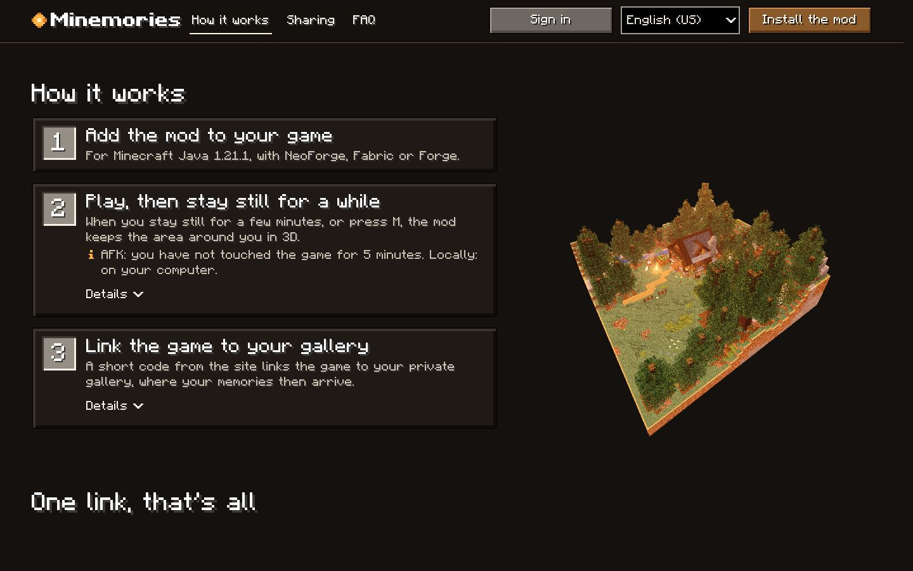
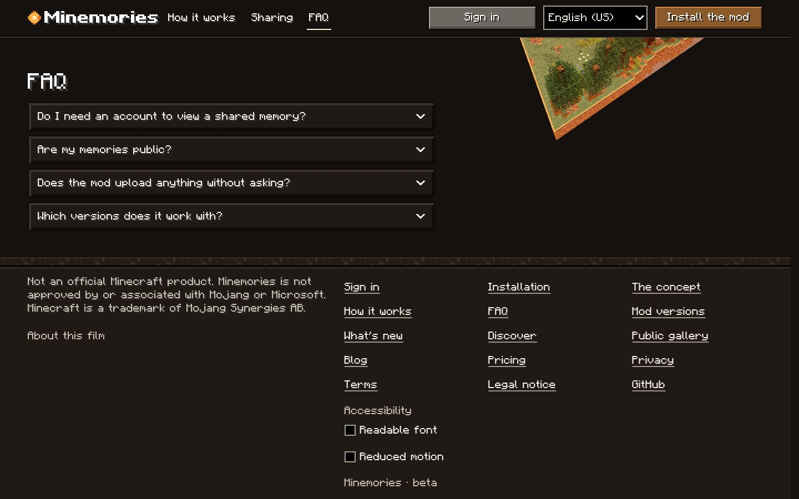

# Minemories design system

The landing page (`/`) is the **reference**; since November 2026 every app page follows it (see "App pages"). Art direction: the Minecraft interface (the game's pixel font, bevelled panels, 2 px borders, one-texel text shadow, warm night colors) with restrained motion. The hero film and its HUD are out of scope: the design system lives **below the film** (`.site`, header, footer).

## Where things are

| File (`apps/web/src/`) | Role |
|---|---|
| `hero/tokens.css` | **Design system tokens (single source)**: type scale, spacing, targets, shadows, focus, motion durations and curves. Loaded on every page (`main.tsx`). |
| `hero/kit.css` | The game kit (`mc-*`: fonts, colors and materials, buttons, panels, slots, tooltips, forms, sections, steps, FAQ, footer, "Readable font" option). Loaded on every page. The `@font-face` rules between markers are written by the prototype's generators. |
| `hero/film.css` | The landing film (HUD, phases, header and 3D panel of `/`). Global styles (`html`, `body`): injected only on `/` by `HeroFilm.tsx`. |
| `hero/charter.css` | Design system components below the film (`.site`), injected after `film.css` on `/`. |
| `charter-app.css` | **The design system on app pages**: base, header, footer, app buttons, cards, notes, list loading. Loaded after the kit. |
| `components/site-nav.css` | The site's bar (`SiteNav.tsx`) on every page and on the landing: menus, account, language picker, install button, phones' panel. Loaded after `charter-app.css` (`main.tsx`). |
| `lib/reveal.ts` | Scroll-in of landing blocks (tested, 100% coverage). |
| `lib/display-preferences.ts` | "Readable font" and "Reduced motion" options (keys `mcui-font`, `mcui-motion`) and the `html.mm-cjk` class, on every page. |

**Rule: a component never hardcodes a size, duration or distance; it reads a `--ds-*` token.**

## Principles

1. **Two voices.** The game font (8-texel pixel font: sizes 16, 24, 32, 40 are crisp) is for titles and controls; reading text uses Atkinson Hyperlegible Next (token `--ds-f-text`, section 8 of `charter.css`). Nothing above 40 px outside the film. Korean and Japanese (Unifont) keep the game font everywhere, in multiples of 16.
2. **One body size.** 16 px on 24 px everywhere (the 24 px desktop size is gone), 58-character measure (`--ds-measure`).
3. **Everything tappable is 44 px tall** (`--ds-hit`): buttons, links, FAQ rows, summaries, checkboxes (the row, not the box).
4. **Game relief, no blurred shadows.** 2 px border (`--gp`), inner bevel, one-texel text shadow (2 px at 16, 3 at 24, 4 at 32, 5 at 40).
5. **Content is visible by default.** Without JavaScript, without WebGL, with reduced motion: nothing is hidden or offset.
6. **The film canvas does not move.** The 0 px freezes and pixel identity with the prototype are invariants (see the log).

## Tokens

| Token | Value | Use |
|---|---|---|
| `--ds-fs-h1` / `--ds-lh-h1` | 32/40 px, 40/48 px from 640 px | hero title |
| `--ds-fs-h2` / `--ds-lh-h2` | 32/40 px | section title |
| `--ds-fs-h3` / `--ds-lh-h3` | 24/32 px | card or step title |
| `--ds-fs-lead` / `--ds-lh-lead` | 16/24 px, 24/32 px from 1,000 px | hero lead (the only text above 16 px) |
| `--ds-fs-md` / `--ds-lh-md` | 16/24 px | body text, lists, answers |
| `--ds-fs-xs` / `--ds-lh-xs` | 16/24 px | meta, footer, buttons |
| `--ds-measure` | 58ch | maximum line length |
| `--ds-sp-1` to `--ds-sp-8` | 4, 8, 12, 16, 24, 32, 48, 64 px | spacing (4 px step) |
| `--ds-section-y` | 32 px, 48 px from 640 px | vertical breathing room of a section |
| `--ds-hit` | 44 px | minimum target height |
| `--ds-focus`, `--ds-focus-offset` | 2 px light, 2 px offset | focus ring for every control |
| `--ds-text-shadow-1` to `-4` | 2, 3, 4, 5 px | text shadow per size |
| `--ds-panel-bevel` | 4 px bevel | "Minecraft interface" panel |
| `--ds-dur-1` to `-4` | 120, 200, 360, 560 ms | hover/press, state change, scroll-in and panel opening, hero entrance |
| `--ds-ease`, `--ds-ease-std`, `--ds-ease-pop` | `cubic-bezier(.2,.8,.2,1)`, `(.4,0,.2,1)`, `(.34,1.56,.64,1)` | soft arrival, back and forth, small bounce |
| `--ds-reveal-y`, `--ds-stagger` | 12 px, 60 ms | entrance offset, gap between siblings |

Colors (kit): background `--night` `#14110e`, panels `--night-2`, text `--text` `#f4efe6` (≥ 15:1), secondary text `--text-2` (≥ 9.6:1), action `--copper` (primary button, 5.9:1), ember `--ember` (hover, open state), focus `--hover`.

## Components

| Component | Classes | Rules |
|---|---|---|
| Button | `mc-btn`, `mc-btn--primary`, `--auto` | 44 px; game relief; hover: light outline + 1 px up; press: pushed-in relief; focus: `--ds-focus` ring. Only one primary per area. |
| Link | `mc-link` | underlined, 44 px target, underline thickens on hover, amber on hover. |
| Step card | `mc-step` (+ `mc-step__num`, `__title`, `__body`, `__more`) | 24 px title, 16 px body, number in a hotbar slot, details in `
`. |
| Info panel | `mc-tip`, `mc-limits` | 16 px text, title in item-name color. |
| Section header | `mc-section`, `mc-section__title`, `mc-section__text` | 32 px title, 58ch text, `--ds-section-y` breathing room. |
| FAQ | `mc-faq`, `mc-faq__item`, `__q`, `__a` | 48 px row, rotating chevron (200 ms), question turns amber once open. |
| Link list | `site-links` | 44 px links, wrapping columns. |
| Footer | `mc-footer`, `.footer` | two columns from 900 px (legal notices | 11 rem link grid), 44 px links. |
| Form | `mc-select`, `mc-check` | select (44 px), checkboxes with a 44 px row. The bar's language picker is `LanguagePicker` (see Site bar), not a native select. |

Screenshots (after):

## Motion rules

- Four durations (120, 200, 360 ms, plus 560 ms for the hero entrance) and three curves (including a 6% bounce reserved for badges, icons and numbers); nothing longer, nothing looping below the film. Full catalog: [brand-guidelines.md](brand-guidelines.md), section 9.
- **Scroll-in** (`reveal.ts`): 12 px offset + fade, **transform and opacity only** (no layout shift), once per block, siblings staggered by 60 ms (up to 4). Selection: section titles and texts, steps, the "limits" panel, link list, FAQ rows, final call to action, footer.
- Hover, press, focus and FAQ opening: 120 to 200 ms transitions on color, outline, transform and chevron.
- **Reduced motion**: `prefers-reduced-motion`, or the "Reduced motion" option in the footer: no entrance, no transition, no movement; the content is simply there.
- **No more than two flashes per second**: no brightness animation; the film keeps its own safeguards (scrub.js, S1 to S16).
- No animation gets in the way of reading: nothing moves inside a text block that is already displayed.

## Accessibility

- Contrast ≥ 4.5:1 for all text (measured: the lowest is the primary button, 5.87:1).
- Visible focus everywhere (2 px light ring); Tab order = DOM order: skip link, film bar, header, content, footer, 3D panel.
- 44 px tall targets (still below 44 px: the checkboxes themselves, whose row is 44 px).
- "Readable font" option (Atkinson Hyperlegible Next): titles follow the same scale.
- Page language kept up to date (`<html lang>`), proper nouns and parameters preserved in all 11 languages.

## Landing audit (before)

Measured in Chromium (`getComputedStyle`, 360, 390, 820, 1440, 1920 px). Issues found, with the fix:

| Finding (before) | Fix |
|---|---|
| Actual scale 16 / 24 / 32 / **48** px: 48 px section titles and 24 px body on 32 px lines from 1,280 px ("way too big"); 4 contradicting rule sets (`mcui.css`, `hero.css`, `site.css`, 2 desktop blocks) | Single 16 / 24 / 32 / 40 scale; desktop blocks removed; everything read from `tokens.css`. |
| Footer broken from 900 px: legal-notice column 108 px wide and 1,100 px tall (crushed by the row of 14 links) | Two columns `5fr / 7fr`, links in an 11 rem grid. |
| 12 to 13 targets < 44 px (16 px tall section links, 40 px "Sign in" button) | Links and buttons at 44 px; checkboxes remain (44 px row). |
| Measure: 24 px text over 734 px = 29 to 45 characters per line, uneven depending on size | `--ds-measure: 58ch` everywhere. |
| No motion below the film, except the phase transition | Scroll-in, hover and press states, FAQ chevron. |
| Contrast | All ≥ 5.87:1: nothing to fix. |

## Before / after (sizes in px, font size / line height)

| Element | 360 before | 360 after | 1440 before | 1440 after | 1920 before | 1920 after |
|---|---|---|---|---|---|---|
| Hero title (h1) | 32/40 px | 32/40 px | 48/56 px | 40/48 px | 48/56 px | 40/48 px |
| Hero lead | 16/24 px | 16/24 px | 24/32 px | 24/32 px | 24/32 px | 24/32 px |
| Section title (h2) | 32/40 px | 32/40 px | 48/56 px | 32/40 px | 48/56 px | 32/40 px |
| Step title (h3) | 24/30 px | 24/32 px | 32/40 px | 24/32 px | 32/40 px | 24/32 px |
| Step body | 16/24 px | 16/24 px | 24/32 px | 16/24 px | 24/32 px | 16/24 px |
| Section text | 16/24 px | 16/24 px | 24/32 px | 16/24 px | 24/32 px | 16/24 px |
| FAQ question | 16/24 px | 16/24 px | 16/24 px | 16/24 px | 16/24 px | 16/24 px |
| FAQ answer | 16/24 px | 16/24 px | 24/32 px | 16/24 px | 24/32 px | 16/24 px |
| "Limits" list | 16/24 px | 16/24 px | 24/32 px | 16/24 px | 24/32 px | 16/24 px |
| Section link | 16/24 px | 16/24 px | 16/24 px | 16/24 px | 16/24 px | 16/24 px |
| Footer: legal notice | 16/24 px | 16/24 px | 16/24 px | 16/24 px | 16/24 px | 16/24 px |
| Footer: link | 16/24 px | 16/24 px | 16/24 px | 16/24 px | 16/24 px | 16/24 px |
| Button | 16/18 px | 16/18 px | 16/18 px | 16/18 px | 16/18 px | 16/18 px |

| Measurement | 360 | 390 | 820 | 1440 | 1920 |
|---|---|---|---|---|---|
| Actual font size scale, before | 16:99 24:3 32:8 | 16:99 24:3 32:8 | 16:99 24:3 32:7 48:1 | 16:81 24:18 32:6 48:5 | 16:81 24:18 32:6 48:5 |
| Actual font size scale, after | 16:99 24:3 32:8 | 16:99 24:3 32:8 | 16:99 24:3 32:7 40:1 | 16:97 24:5 32:7 40:1 | 16:97 24:5 32:7 40:1 |
| Targets < 44 px, before → after | 12 → 5 | 12 → 5 | 12 → 5 | 13 → 5 | 13 → 5 |
| Page height (px), before → after | 4364 → 4832 | 4301 → 4765 | 3684 → 3798 | 4042 → 3266 | 4006 → 3314 |
| Lowest text contrast, before → after | 5.87 → 5.87 | 5.87 → 5.87 | 5.87 → 5.87 | 5.87 → 5.87 | 5.87 → 5.87 |

Screenshots before:

## App pages

- **Foundation**: `tokens.css` and `kit.css` are loaded everywhere, then `charter-app.css`. The Tailwind colors in `theme.css` (`paper`, `ink`, `forest`, `lime`…) point to the landing's night palette; `--font-sans` is the reading font, `--font-mono` the game font.
- **Header and footer** (`SiteLayout.tsx`): the landing ones (night bar with a double rule, the logo, the site's bar described below, dirt strip then a `night-2` footer). The footer carries both accessibility options.
- **Buttons**: `buttonDark`, `buttonLime`, `buttonOutline`, `buttonQuiet` (`components/ui.tsx`) are the stone button, the copper button (only one per area), a night button and a flat button.
- **Illustrations**: no more flat drawings. `MemoryScene`, the install illustration and the sign-in panel show isometric views of the landing captures (`public/hero/scenes/*.webp`: chalet, clearing and forest, then the overgrown and forgotten chalet, renders of `S0`, `S2` and `S4`, transparent background). The content header mark (`BlockMark`) is a real grass block with the capture's textures (`grass-block.webp`). The renders come from a throwaway three.js page (capture lights removed, foliage tints corrected like the film's `prepareCapture`, orthographic camera at 35.26°): redo them if the captures change.
- **Titles** h1 to h3 on pages: game font at sizes 40/32/24 (32/32/16 in Korean and Japanese), one-texel shadow. Running text, fields and data stay in the reading font.
- **Fonts**: "MM Minecraft" and Unifont were regenerated with the characters of the app's 11 catalogs (`MM_EXTRA_TEXT` in the prototype's `mcatlas.mjs`: `MM_EXTRA_TEXT=$(ls apps/web/src/i18n/locales/*.json | tr '\n' ':') node gen-mcfont.mjs && node gen-unifont.mjs`, then copy the woff2 files and the `@font-face` blocks into `kit.css`). Both game faces are preloaded by `index.html`.
- **Loading**: the chunk-loading screen in `index.html` (`scripts/boot-screen/gen.mjs`) only appears on `/`; between pages, the current page stays displayed until the next one arrives (`components/PageFrame.tsx`), then a short fade (`mm-enter`).
- The 3D viewer keeps its scene; only its interface (bars, panels, menus) follows the design system.

## Explainer pages (December 2026 pass)

The nine text-heavy pages (`/concept`, `/how-it-works`, `/faq`, `/privacy`, `/blog/premier-souvenir`, `/sharing`, `/open-source`, `/nostalgia`, `/discover`) were measured at 1440 x 900 by counting the words visible on the first screen (menu included, nothing scrolled): 223, 219, 204, 186, 147, 111, 107, 96 and 94. Studies of web reading (Nielsen Norman Group: about 20 % of the words of an average 593-word page get read; Chartbeat: 55 % of visits last under 15 seconds) say a first screen beyond roughly 100 words is skimmed, not read. The rule since this pass: **a picture or a diagram before a paragraph, an interaction before a diagram, the fine print behind "Details"**.

| Piece | File | Use |
|---|---|---|
| Pixel pictograms | `components/explainers.tsx` (`Glyph`, 8 x 8 texels, reuses `GalleryIcons`) | one per tab, row, chip; always decorative |
| Tab strip + panel | `TabStrip`, `TabPanel` | arrow keys per the ARIA pattern; unselected panels stay in the page (`hidden`) so prerender and search engines still see all the text |
| Command chip | `Command` | a chat command or a path with a copy button |
| Closed details | `More` | the long, exact text (paths, menus, limits) that used to be the page |
| Verdict chip | `VerdictChip` | Yes / No / Not yet / Depends, readable before the answer |
| Diagrams | `components/diagrams.tsx` | `RadiusMap` (top-down map, slider = `/minemories export <radius>`), `ShareDemo` (private, link, revoked), `SeasonDemo` (server closes, memory stays), `DataFlow` (computer, gallery, link), `Pipeline` (selectable boxes) |
| Styles | `components/explainers.css` | same tokens and materials as the rest of the site; one narrow-screen block (grid rows, stacked diagrams) |

Rules: a new explainer string is short (a label, or one sentence) and exists in the 8 full catalogs; the CJK catalogs may only use glyphs already in the Unifont subset (regenerate the font before adding others). Do not move a fact out of the page to shorten it: move it under `More`. Each diagram needs an interaction test (`components/explainers.test.tsx`).

## Open decisions (Andy)

- 16 px body everywhere, including on large screens (readable but small at 1920 px); the alternative is 24 px for the lead only (the current choice) or 20 px (not crisp with the pixel font).
- Component demo page (`/design`): not created in this pass (the landing serves as reference); to do along with the page migration.
- The old "48 px" hero and section sizes were a prototype decision (v11b): they are removed here.

## Site bar

One bar for every page and the landing (`components/SiteNav.tsx`, styles in `components/site-nav.css`); `SiteLayout` puts it after the brand in `.mm-header`, `HeroMarkup` in the landing's `.mc-sitebar`.

- **Data**: `navMenus()` in `content/navigation.ts`, built from the footer's groups so that every public page is one click from the bar: Product (What is Minemories?, How it works, How do I share a link?, See other players’ builds), Guides (Install the mod, Downloads, What if my server shuts down?, Open my build in Blender), Help (FAQ, Is it safe?, What’s new, What’s coming next, Found a bug? Tell us on GitHub, then "Legal" and "Elsewhere": CurseForge, GitHub). The menus list real pages only, the same on the landing as on every page: no shortcuts to the landing's own sections. A named group's heading labels its list (`aria-labelledby`). Keyboard moves and current-page checks are in `lib/site-menu.ts`, the picker's language order and codes in `lib/locale-picker.ts` (both 100% covered).
- **One gutter**: `--mm-bar-gutter` (16 px, 24 px from 1000 px, 8 px under 420 px) pads both `.mm-header` and the landing's `.mc-sitebar`, and the pages keep the scrollbar's room like the landing (`scrollbar-gutter: stable`): the brand, the menus and the install button sit at the same place on every page.
- **Labels only get shorter as the window narrows**: from 1440 px everything is whole (the signed-in name included); 1280 to 1439, the account shows its avatar alone; 960 (`DESKTOP_NAV`) to 1279, the language button shows a globe and the language's code ("DE", "RU"), "Sign in" is a stone button with a pixel head and "Install the mod" says "Install" (the short label uses the long one's verb form: "Installiere", "Установи"); under 960 the three bars take the menus and the account; under 700 the language moves into the panel. The install button always keeps a word, never the ember alone. The hidden names stay the buttons' accessible names.
- **From 960 px** (`DESKTOP_NAV`): the three menus are disclosure buttons (`aria-expanded`, `aria-controls`) over night panels with the kit's dark bevel (2 texels, `.mc-panel--dark`) and 2 px outline, each panel's left edge on its button's. Ember means "the page on screen" or "open" and nothing else: a hovered button or row takes the game buttons' light 2 px outline, an open menu's name is ember, the page on screen is an ember row with an ember edge (`aria-current="page"`) and its menu's name has an ember bar under it, as thick as that edge. Long names wrap inside the panel (at most 420 px wide). Click or Enter opens, Down opens on the first link (or goes into a menu already open), Up/Down/Home/End move through the links, Left/Right/Home/End move along the bar's menu buttons, the account's included (an open menu follows), Escape closes and gives the focus back only if it was in the menu, on its button or nowhere; focus moving to another menu's button or leaving the bar, or a press outside, closes. With a mouse on a fine-pointer screen (`(hover: hover) and (pointer: fine)`), a pointer at rest for 200 ms on a menu's button opens it and 100 ms on a neighbour switches to it from the open one; every move of more than 4 px restarts that wait, so a pointer crossing the bar opens nothing (checked in Chromium at 400, 800 and 1,500 px/s), while one crawling at about 25 px/s counts as resting; leaving the button and its panel closes the menu after 280 ms, so a diagonal move into the panel never closes it (`lib/hover-intent.ts`, `useHoverMenus` in `nav-layers.ts`). A click or a key pins the menu: the pointer leaving no longer closes it, and a click on a menu the pointer opened pins it instead of closing it (the next click closes). A touch never opens anything on hover; the account's menu behaves the same. A link to the page already on screen closes the menu and puts the focus back on its button. Then the account, the language and "Install the mod".
- **Account**: "Sign in", or a stone button like its neighbours (the avatar in its slot, the name from 1440 px) opening a menu headed by who is signed in (whole name, address under it), then My gallery and My account, and after a rule Administration (when the server confirms the access) and Sign out. The access check starts when the account's button is hovered or focused, so the list is whole when it opens, and its answer stays while the bar is mounted. Signing out goes home and puts the focus on the brand. An open stone button stays pressed (the kit's active bevel): ember text would not read on stone.
- **Language picker** (`LanguagePicker.tsx`): a button with a pixel globe and the language's own name (or code), opening a WAI-ARIA listbox of the eleven languages in their own names, in the picker's own order (by name, each language's regions together: Deutsch · English (US) · English (UK) · English (CA) · Français (FR) · Français (CA) · Polski · Português (BR) · Русский · 日本語 · 한국어), the current one checked: arrows, Home, End, typeahead, Enter or Space to choose, Escape or a press outside to close, Tab goes on from the button. It keeps the app's loading behaviour (`aria-busy`, the error message).
- **Under 960 px**: brand, language (from 700 px), install button and the three bars. They open a modal dialog under the header (`aria-modal`, the rest of the page `inert` while it is open, a 70% dimmed page, the kit's bevel and the bar's outline on its open side): the three groups as stone buttons that unfold their links (the group of the page on screen open), the account as a group of its own (avatar and name; its address, links and, after a rule, Sign out), and, under 700 px, the language. The install button stays in the bar at every width and is never repeated in the panel. One column that never grows past the panel: long names wrap, a long account name ends with an ellipsis, so nothing scrolls sideways. Focus stays between the button and the panel (from the language list, Tab goes on to the next control), Escape (after an open language list), a press outside or a link close it, the page does not scroll meanwhile. No band ever drops under the header on wide screens.
- **Layers** (`--ds-z-*` in `hero/tokens.css`): one stacking scale for the site. Under 10, a layer inside a component or a section (the viewer's bars, the downloads' sticky rows). `--ds-z-page` (30): the page's fixed layers, the landing's canvas strip, dock (31), held film frame (34) and page veil (35), and the pages' toasts (the language suggestion). `--ds-z-chrome` (39): the film's rail. `--ds-z-bar` (50): the bar, on the pages (`.mm-header`) and on the landing (`.mc-sitebar`), with everything it opens (menus, language list, phones' panel) inside its own layer, so an open menu covers anything the page draws. `--ds-z-modal` (60): the gallery's side sheet and its right-click menu. `--ds-z-skip` (100): "Skip to content". The panels hang from the bar's bottom rule, never over the bar (`top` from the button's middle plus half of `--header-h`, the rule and the panel's outline; the pages' bar is 64 px at every width), and a panel taller than the window scrolls inside it.
- **Readable font**: the rows tighten to 40 px (the readable font is smaller than the game's).
- **Prerender**: every panel is in the HTML, closed (`hidden`); the phones' panel draws its language picker only while open, so one picker exists at a time.
- **Motion**: panels drop 8 px while fading in, the close cross pops; none with reduced motion (system or option). Forced colours: outlined panels and rows.
