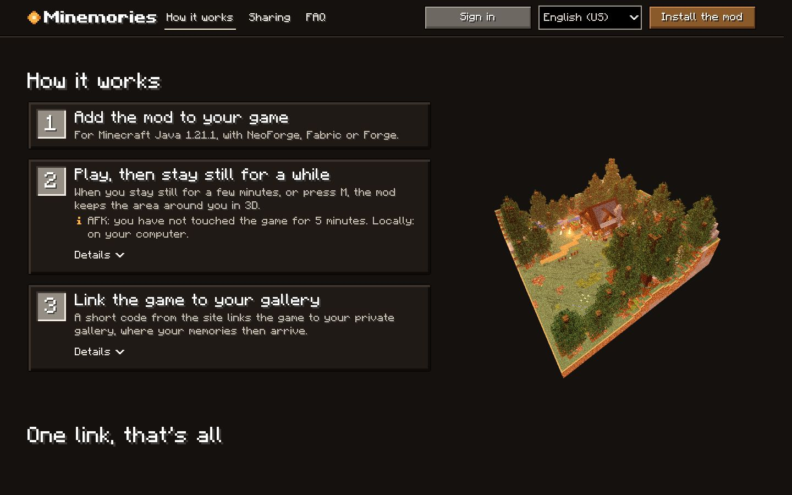
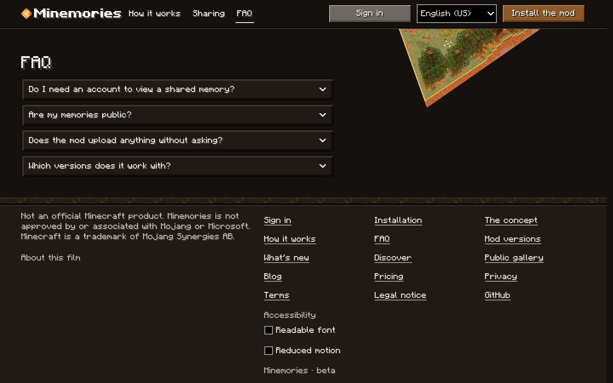
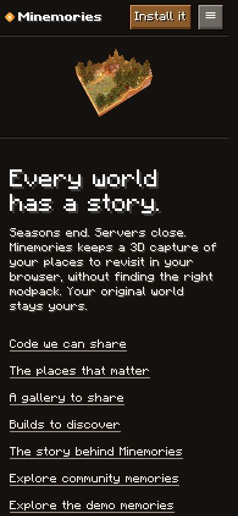
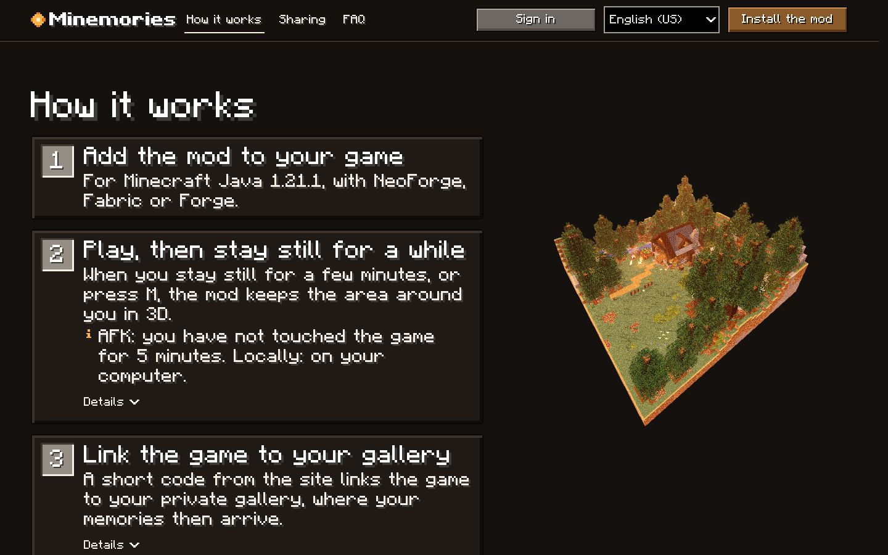
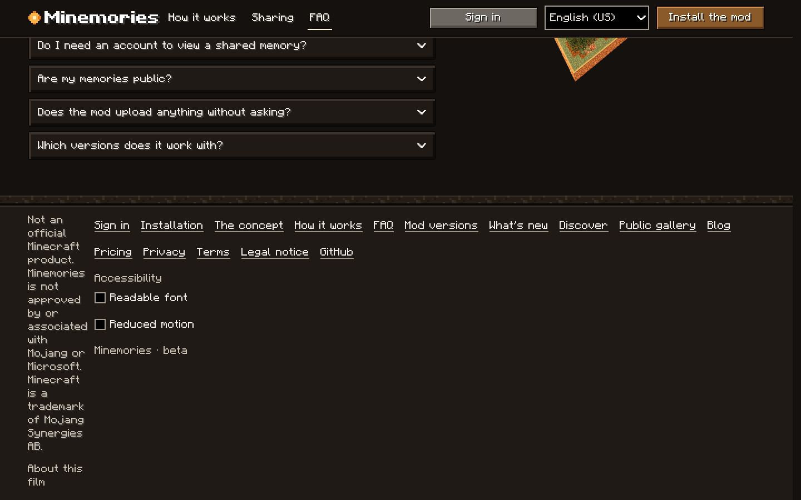

# Charte graphique Minemories (phase 1 : la landing)

La landing (`/`) est la **référence** : les autres pages de l'app reprendront cette charte, page par page (plan en fin de document). Direction artistique : l'interface de Minecraft (police pixel du jeu, panneaux biseautés, bordures de 2 px, ombre de texte d'un texel, couleurs chaudes de nuit) avec un mouvement sobre. Le film du hero et son HUD ne sont pas concernés : la charte vit **sous le film** (`.site`, en-tête, pied de page).

## Où est quoi

| Fichier (`apps/web/src/hero/`) | Rôle |
|---|---|
| `tokens.css` | **Jetons de la charte (source unique)** : échelle typographique, espacement, cibles, ombres, focus, durées et courbes de mouvement. |
| `film.css` | Le kit du jeu (`mc-*` : boutons, panneaux, FAQ, étapes, pied de page, HUD) et ses jetons de matière (`--night`, `--text`, `--copper`, `--ember`, `--gp` = le pixel de 2 px). Hérité du prototype ; les anciennes règles de taille de bureau (24 px, 48 px) en ont été retirées. |
| `charter.css` | **Composants partagés de la charte** : échelle appliquée aux titres et au texte, rythme vertical, boutons, liens, cartes, pied de page, entrées au défilement. Chargé après le kit. |
| `src/lib/reveal.ts` | Entrée des blocs au défilement (testé, 100 % de couverture). |

Les trois feuilles sont concaténées dans cet ordre par `HeroFilm.tsx` (`tokens`, `film`, `charter`) et injectées dans un `<style>` qui n'existe que sur la page d'accueil. **Règle : un composant n'écrit jamais une taille, une durée ou une distance en dur ; il lit un jeton `--ds-*`.**

## Principes

1. **Deux voix.** La police du jeu (pixel de 8 texels : tailles 16, 24, 32, 40 nettes) titre et commande ; le texte de lecture est en Atkinson Hyperlegible Next (jeton `--ds-f-text`, section 8 de `charter.css`). Rien au-dessus de 40 px hors du film. Le coréen et le japonais (Unifont) gardent la police du jeu partout et des multiples de 16.
2. **Un corps de texte.** 16 px sur 24 px partout (le 24 px de bureau est retiré), mesure de 58 caractères (`--ds-measure`).
3. **Tout ce qui se touche fait 44 px de haut** (`--ds-hit`) : boutons, liens, lignes de FAQ, résumés, cases à cocher (la ligne, pas la case).
4. **Relief du jeu, pas d'ombres floues.** Bordure de 2 px (`--gp`), biseau intérieur, ombre de texte d'un texel (2 px à 16, 3 à 24, 4 à 32, 5 à 40).
5. **Le contenu est visible par défaut.** Sans JavaScript, sans WebGL, en mouvement réduit : rien n'est masqué ni décalé.
6. **Le canvas du film ne bouge pas.** Les gels à 0 px et l'identité au pixel avec le prototype sont des invariants (voir le journal).

## Jetons

| Jeton | Valeur | Usage |
|---|---|---|
| `--ds-fs-h1` / `--ds-lh-h1` | 32/40 px, 40/48 px dès 640 px | titre du hero |
| `--ds-fs-h2` / `--ds-lh-h2` | 32/40 px | titre de section |
| `--ds-fs-h3` / `--ds-lh-h3` | 24/32 px | titre de carte ou d'étape |
| `--ds-fs-lead` / `--ds-lh-lead` | 16/24 px, 24/32 px dès 1 000 px | chapeau du hero (seul texte au-dessus de 16 px) |
| `--ds-fs-md` / `--ds-lh-md` | 16/24 px | corps du texte, listes, réponses |
| `--ds-fs-xs` / `--ds-lh-xs` | 16/24 px | méta, pied de page, boutons |
| `--ds-measure` | 58ch | longueur de ligne maximale |
| `--ds-sp-1` à `--ds-sp-8` | 4, 8, 12, 16, 24, 32, 48, 64 px | espacement (pas de 4) |
| `--ds-section-y` | 32 px, 48 px dès 640 px | respiration verticale d'une section |
| `--ds-hit` | 44 px | hauteur minimale d'une cible |
| `--ds-focus`, `--ds-focus-offset` | 2 px clair, décalé de 2 px | anneau de focus de tout ce qui se commande |
| `--ds-text-shadow-1` à `-4` | 2, 3, 4, 5 px | ombre de texte par taille |
| `--ds-panel-bevel` | biseau 4 px | panneau « interface Minecraft » |
| `--ds-dur-1`, `-2`, `-3` | 120, 200, 360 ms | survol/pression, changement d'état, entrée au défilement |
| `--ds-ease`, `--ds-ease-std` | `cubic-bezier(.2,.8,.2,1)`, `(.4,0,.2,1)` | arrivée douce, aller-retour |
| `--ds-reveal-y`, `--ds-stagger` | 12 px, 60 ms | décalage d'entrée, écart entre frères |

Couleurs (kit) : fond `--night` `#14110e`, panneaux `--night-2`, texte `--text` `#f4efe6` (≥ 15:1), texte secondaire `--text-2` (≥ 9,6:1), action `--copper` (bouton primaire, 5,9:1), braise `--ember` (survol, état ouvert), focus `--hover`.

## Composants

| Composant | Classes | Règles |
|---|---|---|
| Bouton | `mc-btn`, `mc-btn--primary`, `--auto` | 44 px ; relief du jeu ; survol : contour clair + 1 px vers le haut ; pression : relief enfoncé ; focus : anneau `--ds-focus`. Un seul primaire par zone. |
| Lien | `mc-link` | souligné, cible 44 px, le soulignement s'épaissit au survol, ambre au survol. |
| Carte d'étape | `mc-step` (+ `mc-step__num`, `__title`, `__body`, `__more`) | titre 24 px, corps 16 px, numéro en case de barre d'objets, détails en `
`. |
| Panneau d'info | `mc-tip`, `mc-limits` | texte 16 px, titre en couleur de nom d'objet. |
| En-tête de section | `mc-section`, `mc-section__title`, `mc-section__text` | titre 32 px, texte 58ch, respiration `--ds-section-y`. |
| FAQ | `mc-faq`, `mc-faq__item`, `__q`, `__a` | ligne 48 px, chevron qui tourne (200 ms), question ambre une fois ouverte. |
| Liste de liens | `site-links` | liens de 44 px, colonnes qui passent à la ligne. |
| Pied de page | `mc-footer`, `.footer` | deux colonnes dès 900 px (mentions | grille de liens de 11 rem), liens de 44 px. |
| Formulaire | `mc-select`, `mc-check` | sélecteur de langue compact (44 px), cases à cocher à ligne de 44 px. |

Captures (après) :

## Règles de mouvement

- Trois durées (120, 200, 360 ms), deux courbes ; rien de plus long, rien qui boucle sous le film.
- **Entrée au défilement** (`reveal.ts`) : décalage de 12 px + fondu, **transform et opacité seulement** (aucun saut de mise en page), une fois par bloc, frères décalés de 60 ms (jusqu'à 4). Sélection : titres et textes de section, étapes, panneau « limites », liste de liens, lignes de FAQ, appel final, pied de page.
- Survol, pression, focus et ouverture de FAQ : transitions de 120 à 200 ms sur couleur, contour, transform et chevron.
- **Mouvement réduit** : `prefers-reduced-motion`, ou l'option « Mouvement réduit » du pied de page : aucune entrée, aucune transition, aucun déplacement ; le contenu est là.
- **Pas plus de deux flashs par seconde** : aucune animation de luminosité ; le film garde ses propres garde-fous (scrub.js, S1 à S16).
- Aucune animation ne gêne la lecture : rien ne bouge dans un bloc de texte déjà affiché.

## Accessibilité

- Contraste ≥ 4,5:1 pour tout texte (mesuré : le plus faible est le bouton primaire, 5,87:1).
- Focus visible partout (anneau de 2 px clair) ; ordre de Tab = ordre du DOM : lien d'évitement, barre du film, en-tête, contenu, pied de page, panneau 3D.
- Cibles de 44 px de haut (reste sous 44 px : les cases à cocher elles-mêmes, dont la ligne fait 44 px).
- Option « Police lisible » (Atkinson Hyperlegible Next) : les titres suivent la même échelle.
- Langue de la page à jour (`<html lang>`), noms propres et paramètres préservés dans les 11 langues.

## Audit de la landing (avant)

Mesures dans Chromium (`getComputedStyle`, 360, 390, 820, 1440, 1920 px). Problèmes constatés, avec la correction :

| Constat (avant) | Correction |
|---|---|
| Échelle réelle 16 / 24 / 32 / **48** px : titre de section 48 px et corps 24 px sur 24 lignes de 32 px dès 1 280 px (« méga gros ») ; 4 jeux de règles qui se contredisent (`mcui.css`, `hero.css`, `site.css`, 2 blocs de bureau) | Échelle unique 16 / 24 / 32 / 40 ; blocs de bureau retirés ; tout lu dans `tokens.css`. |
| Pied de page cassé dès 900 px : colonne des mentions légales de 108 px de large, 1 100 px de haut (la rangée de 14 liens l'écrasait) | Deux colonnes `5fr / 7fr`, liens en grille de 11 rem. |
| 12 à 13 cibles < 44 px (liens de section de 16 px de haut, bouton « Se connecter » de 40 px) | Liens et boutons à 44 px ; reste les cases à cocher (ligne de 44 px). |
| Mesure : texte à 24 px sur 734 px = 29 à 45 caractères par ligne, irrégulier selon la taille | `--ds-measure: 58ch` partout. |
| Aucun mouvement sous le film, sauf la transition de phase | Entrée au défilement, états de survol et de pression, chevron de FAQ. |
| Contrastes | Tous ≥ 5,87:1 : rien à corriger. |

## Avant / après (tailles en px, police / interligne)

| Élément | 360 avant | 360 après | 1440 avant | 1440 après | 1920 avant | 1920 après |
|---|---|---|---|---|---|---|
| Titre du hero (h1) | 32/40 px | 32/40 px | 48/56 px | 40/48 px | 48/56 px | 40/48 px |
| Chapeau du hero | 16/24 px | 16/24 px | 24/32 px | 24/32 px | 24/32 px | 24/32 px |
| Titre de section (h2) | 32/40 px | 32/40 px | 48/56 px | 32/40 px | 48/56 px | 32/40 px |
| Titre d’étape (h3) | 24/30 px | 24/32 px | 32/40 px | 24/32 px | 32/40 px | 24/32 px |
| Corps d’étape | 16/24 px | 16/24 px | 24/32 px | 16/24 px | 24/32 px | 16/24 px |
| Texte de section | 16/24 px | 16/24 px | 24/32 px | 16/24 px | 24/32 px | 16/24 px |
| Question de FAQ | 16/24 px | 16/24 px | 16/24 px | 16/24 px | 16/24 px | 16/24 px |
| Réponse de FAQ | 16/24 px | 16/24 px | 24/32 px | 16/24 px | 24/32 px | 16/24 px |
| Liste « limites » | 16/24 px | 16/24 px | 24/32 px | 16/24 px | 24/32 px | 16/24 px |
| Lien de section | 16/24 px | 16/24 px | 16/24 px | 16/24 px | 16/24 px | 16/24 px |
| Pied : mention légale | 16/24 px | 16/24 px | 16/24 px | 16/24 px | 16/24 px | 16/24 px |
| Pied : lien | 16/24 px | 16/24 px | 16/24 px | 16/24 px | 16/24 px | 16/24 px |
| Bouton | 16/18 px | 16/18 px | 16/18 px | 16/18 px | 16/18 px | 16/18 px |

| Mesure | 360 | 390 | 820 | 1440 | 1920 |
|---|---|---|---|---|---|
| Échelle de tailles de police réelle, avant | 16:99 24:3 32:8 | 16:99 24:3 32:8 | 16:99 24:3 32:7 48:1 | 16:81 24:18 32:6 48:5 | 16:81 24:18 32:6 48:5 |
| Échelle de tailles de police réelle, après | 16:99 24:3 32:8 | 16:99 24:3 32:8 | 16:99 24:3 32:7 40:1 | 16:97 24:5 32:7 40:1 | 16:97 24:5 32:7 40:1 |
| Cibles < 44 px, avant → après | 12 → 5 | 12 → 5 | 12 → 5 | 13 → 5 | 13 → 5 |
| Hauteur de la page (px), avant → après | 4364 → 4832 | 4301 → 4765 | 3684 → 3798 | 4042 → 3266 | 4006 → 3314 |
| Contraste texte le plus faible, avant → après | 5.87 → 5.87 | 5.87 → 5.87 | 5.87 → 5.87 | 5.87 → 5.87 | 5.87 → 5.87 |

Captures avant :

## Étendre la charte aux autres pages (plan, non fait dans cette passe)

Une page adopte la charte en : (1) portant `.ds-page` (ou `.site`) sur sa racine ; (2) utilisant les classes `mc-*` ci-dessus ; (3) chargeant `tokens.css` + `charter.css` (aujourd'hui injectés par `HeroFilm`, à déplacer dans un `DesignSystemStyles` partagé quand la 2e page migrera) ; (4) ne définissant aucune taille en dur. Ordre proposé, du plus public au plus privé :

1. `/installation`, `/concept`, `/fonctionnement`, `/faq`, `/versions`, `/changelog` (pages de guides : titres, étapes, FAQ, listes) ;
2. `/decouvrir`, `/open-source`, `/nostalgie`, `/partager`, `/classement`, `/explorer` (cartes, grilles) ;
3. `/blog`, `/pricing`, `/privacy`, `/terms`, `/legal` (texte long : `mc-section__text`, mesure) ;
4. `/login`, `/register`, `/account` (formulaires : `mc-select`, `mc-check`, champs, boutons) ;
5. `/gallery`, `/share`, `/public`, `/moderation`, `/admin`, `/viewer` (interfaces denses : à décider avec Andy, le viewer garde sa propre interface).

L'en-tête et le pied de page du film (compacts, pleine largeur) sont à extraire en composants de l'app (`SiteHeader`, `SiteFooter`) à la première migration, pour remplacer `SiteLayout` et son thème Tailwind.

## Décisions à trancher (Andy)

- Corps à 16 px partout, y compris sur grand écran (lisible mais petit sur 1920 px) ; l'alternative est 24 px pour le chapeau seulement (c'est le cas) ou 20 px (non net avec la police pixel).
- Page de démonstration des composants (`/design`) : non créée dans cette passe (la landing sert de référence) ; à faire avec la migration des pages.
- Les anciens « 48 px » du hero et des sections étaient une décision du prototype (v11b) : ils sont supprimés ici.
